# Ballast contracts

Six Soroban contracts (Rust) plus `common`, a shared library of access-control, timelock, pause,
price, risk, and margin logic used across all of them. See `../PRD.md` §6.2 and §8 for the design
and interface each one implements, and each crate's own module doc comment for what's simplified
in this skeleton pass.

| Crate | Responsibility |
|---|---|
| `common` | [Shared roles, timelock, pause, price, risk, and margin logic](common/README.md) — not itself a deployable contract |
| `registry` | [Asset configs, haircut parameters, timelocked param changes](registry/README.md) |
| `price-guard` | [Median/band/staleness/halt price logic (PRD §6.4)](price-guard/README.md) |
| `pledge-vault` | [Escrow/lien collateral positions](pledge-vault/README.md) |
| `credit-line` | [Credit lines, draws, repayments, storage layout, and the margin state machine](credit-line/README.md) |
| `exit-desk` | [RWA → USDC instant exit](exit-desk/README.md) |
| `repo-dvp` | Bilateral repo, atomic DvP |

Every event these contracts publish (topics, payload order and types, emitter, consumers) is listed
in [`EVENTS.md`](EVENTS.md). Payload order is a compatibility contract with `services/indexer` and
`services/ledger`: read that file before you change an event.

## Differences from PRD section 8

The PRD (`../PRD.md` §8) is the product doc and is untouched; this table is where the code
diverges from it, so a reader who trusts the PRD writes clients against the right shapes. Each
row is verified against the code at the cited lines. Status is one of `intended` (a deliberate
design choice), `planned` (tracked work, not yet built) or `bug` (the code does something the
PRD does not allow, or silently drops something it promises).

| Item | PRD says | Code does | Status |
|---|---|---|---|
| `open` gains `asset` | §8 (`PRD.md:555`): `open(lender, borrower, limit, rate_bps, cure_s, agreement)` — no asset | `open` takes `asset: Address` (`contracts/credit-line/src/lib.rs:329`) | intended — a line must know its collateral asset; the §7 data model ties a line to an asset |
| One position per (borrower, asset) | §6.2 (`PRD.md:349`): "One position per (borrower, asset)" | `open` allocates a fresh line id with no check for an existing line for the same (borrower, asset) (`contracts/credit-line/src/lib.rs:325`); vault positions are keyed `(line, asset)` (`contracts/pledge-vault/src/lib.rs:135`), so one borrower can hold two positions for one asset | bug — no tracking issue |
| `liquidate(route)` ignores `route` | §8 (`PRD.md:561`): `liquidate(keeper, line, route)` | the parameter is accepted and discarded (`let _ = route;`, `contracts/credit-line/src/lib.rs:613`) | bug — no tracking issue |
| `cure_s` stored, never enforced | §8 (`PRD.md:555`) passes `cure_s` to `open`; invariant 3 requires an "expired cure window" before liquidation | `cure_s` is stored on the `Line` (`contracts/credit-line/src/lib.rs:143,360`) and never read; the "no quick liquidation" rule is instead enforced by requiring the breach to have been flagged by a `poke` on an earlier ledger | bug — #147 |
| `fee_bps` has no on-chain effect | §7 (`PRD.md:496`): the `credit_line` table has `fee_bps`; §5 says the platform fee "is taken on top" | no `fee_bps` anywhere in `contracts/`; it never reaches `open`, `Line`, or `repay` | planned — #146, #920 |
| `owed` provides payoff & accrual components | §9 (`PRD.md:606`): `GET /v1/credit-lines/{id}` returns "limit, drawn, LTV, state, next accrual" | `owed(line) -> Owed` returns principal, booked and pending interest, booked and pending platform fee, the total (always equal to `debt_of`) and `as_of`, without a PriceGuard call | intended (#131, #918) |
| `publish_nav` gains `asset_code` | §8 (`PRD.md:545`): `publish_nav(publisher, asset, value, ts, sig)` | `publish_nav` takes an extra `asset_code: Bytes` (`contracts/price-guard/src/lib.rs:989`) for the issuer-signature check | intended — a deliberate breaking change, documented in "price-guard's `publish_nav`" below |
| `unpause` is queue + execute | §8 (`PRD.md:542`): `unpause(admin, scope)` (timelocked) | no `unpause` entry point; instead `queue_unpause` (`contracts/registry/src/lib.rs:286`) + `execute_unpause` (`:323`), implementing the 48h timelock as an explicit two-step flow | intended |
| `propose` flattens `RepoTerms` | §8 (`PRD.md:568`): `propose(cash_lender, terms: RepoTerms)` | `propose` takes the terms as separate parameters — `cash_lender, cash_borrower, asset, units, cash_amount, rate_bps, kind, maturity_at, agreement_hash` (`contracts/repo-dvp/src/lib.rs:597`); no `RepoTerms` type exists, and `cash_borrower` is named up front where the PRD only brings the borrower in at `accept_and_settle` | intended |
| `repay` returns the applied amount | §8 (`PRD.md:558`): `repay(payer, line, amount)` (no return shown) | `repay(...) -> i128`, returning the amount applied (`min(amount, owed)`) (`contracts/credit-line/src/lib.rs:529`) | intended |

One item from the issue's original list is no longer a difference: `release` now requires the
post-release LTV to stay `Healthy`, matching the PRD (fixed in #1116, closing #181).

## Pause scopes

`ballast-common::pause::PauseScope` has four targeted scopes plus an `All` override that `is_paused`
applies to every scope. This is the complete map of what each scope gates, taken from the
`pause::require_not_paused` call sites:

| Scope | Contract | Entry point | Gated |
|---|---|---|---|
| `Pledges` | `pledge-vault` | `pledge` | yes |
| `Draws` | `credit-line` | `draw` | yes |
| `Exits` | `exit-desk` | `exit` | yes |
| `Repos` | `repo-dvp` | `accept_and_settle` | yes |
| `All` | n/a | none; overrides every scope above | n/a |

### Intentionally ungated

These move no new risk, so they stay callable while a scope (or `All`) is paused. PRD §8
invariant 5 ("pausing cannot move funds") requires it.

| Contract | Entry point | Why it is not gated |
|---|---|---|
| `credit-line` | `repay` | Repayment must always work. |
| `credit-line` | `liquidate`, `close_liquidated` | Liquidation must run while paused, or a bad line can never be cleared. |
| `credit-line` | `withdraw_undrawn`, `withdraw_interest` | The lender taking its own capital back out only lowers exposure. |
| `pledge-vault` | `release` | The borrower returning collateral; checked to leave the line healthy when the line still owes something (with zero debt the price and LTV checks are skipped, #182). |
| `pledge-vault` | `liquidate` | The keeper seizing collateral must work while paused. |
| `repo-dvp` | `unwind` | Leg 2 at or after maturity closes the trade and returns collateral. |
| `repo-dvp` | `top_up` | Adds collateral; a borrower must be able to cure a call while paused. |
| `repo-dvp` | `call_margin`, `default_close` | Keeper evaluation and enforcement must keep running. |
| `exit-desk` | `withdraw` | The desk withdrawing its own balance, not a holder's funds. |

Read-only entry points (`quote`, `ltv`, `margin_view` and the other getters) are ungated as well.

### Known gaps

- `repo-dvp::propose` is not gated, although `require_not_paused`'s doc comment treats a new repo as
  new risk. Tracked in #846.
- The gating contracts read pause flags from their own storage and only `Registry::pause` writes a
  flag, so a flag cannot currently be set on the contract that checks it. Tracked in #30 and #32.

## Credit-line lifecycle

The credit line has two independent dimensions:

- `LineStatus`: `Open`, `Liquidating`, or `Closed`
- `MarginState`: `Healthy`, `Warning`, `MarginCall`, or `Liquidation`

Status and margin state are orthogonal: an `Open` line can be `Warning`, `MarginCall`, or `Liquidation`; only `liquidate` changes `Open` to `Liquidating`. A line reaches `Closed` in one of two ways: `close_liquidated` from `Liquidating`, or `close` from `Open` once the line is fully repaid and the lender has withdrawn all funding (#130).

```mermaid
stateDiagram-v2
    [*] --> Open: open / lender auth; limit > 0

    state Open {
        [*] --> Healthy

        Healthy --> Healthy: draw / post-draw LTV is Healthy
        Healthy --> Warning: poke / warning range
        Healthy --> MarginCall: poke / margin-call range
        Healthy --> Liquidation: poke / ltv >= liquidation_bps

        Warning --> Healthy: poke / ltv < warning_bps
        Warning --> MarginCall: poke / margin-call range
        Warning --> Liquidation: poke / ltv >= liquidation_bps

        MarginCall --> Healthy: poke / ltv < warning_bps
        MarginCall --> Warning: poke / warning range
        MarginCall --> Liquidation: poke / ltv >= liquidation_bps

        Liquidation --> Healthy: poke / ltv < warning_bps
        Liquidation --> Warning: poke / warning range
        Liquidation --> MarginCall: poke / margin-call range

        Healthy --> Healthy: sync_from_vault / sync_collateral
        Warning --> Warning: sync_from_vault / sync_collateral
        MarginCall --> MarginCall: sync_from_vault / sync_collateral
        Liquidation --> Liquidation: sync_from_vault / sync_collateral
    }

    Open --> Liquidating: liquidate / breach armed and later-ledger Ok liquidation
    Liquidating --> Closed: close_liquidated / lender auth; Liquidating status; vault position empty
    Open --> Closed: close / lender or borrower auth; Open status; nothing owed; funded == 0
    Closed --> [*]

    note right of Open
        poke in Liquidation with an Ok price arms or preserves breach_ledger.
        poke outside Liquidation or with a non-Ok price clears breach_ledger.
        draw, poke, liquidate, and close_liquidated refresh margin_state.
        sync_* changes pledged_units only and does not refresh it.
    end note
```



The exact `MarginState` boundaries are computed by `margin::classify`:

| Margin state | LTV condition |
|---|---|
| `Healthy` | `ltv_bps < warning_bps` |
| `Warning` | `ltv_bps >= warning_bps` and `ltv_bps < margin_call_bps` |
| `MarginCall` | `ltv_bps >= margin_call_bps` and `ltv_bps < liquidation_bps` |
| `Liquidation` | `ltv_bps >= liquidation_bps` |

Every boundary is inclusive on the higher-LTV side (`>=`). The configured threshold names and limits are: `0 < warning_bps < margin_call_bps < liquidation_bps <= 10_000`. `MarginThresholds::validate` is strict, so equal thresholds are rejected (`margin: warning_bps must be below margin_call_bps`, `margin: margin_call_bps must be below liquidation_bps`).

`ltv()` is the source of truth for current margin. It reads debt, collateral, the guarded price, and configured thresholds without persisting state. `Line.margin_state` is only a cache refreshed by `draw`, `poke`, `liquidate`, and `close_liquidated`. `sync_from_vault` and `sync_collateral` change `pledged_units` but deliberately do not refresh the cache; a later `ltv()` or `poke()` can therefore report a state different from stored `Line.margin_state`.

Liquidation is deliberately two-phase. `poke` at `Liquidation` with an `Ok` price stores the current ledger sequence in `breach_ledger`. `liquidate` succeeds only in a later ledger (`current ledger sequence > breach_ledger`), and only if a fresh read remains `Ok` and `Liquidation`. For example, if `poke` runs in ledger 100, it may not liquidate in ledger 100; it may be attempted in ledger 101 or later, but only after the second read confirms the breach.

This is why `Warning` can remain `Open`: status is the lifecycle state, while margin state describes the current LTV band. `Warning` is not a status transition and does not seize collateral or enter liquidation; the line remains `Open` until a separately guarded `liquidate` call succeeds.

| Trigger function | Guard conditions (verbatim panic messages) | Resulting `status` | Resulting `margin_state` | Resulting `breach_ledger` |
|---|---|---|---|---|
| `open` | Lender authorization required. `limit > 0`: `credit-line: limit must be positive` | `Open` | `Healthy` | `None` |
| `draw` | Draws scope not paused: `ballast-common: paused`; borrower authorization; borrower matches line: `credit-line: not this line's borrower`; `amount > 0`: `credit-line: amount must be positive`; status is `Open`: `credit-line: line is not open`; funded-undrawn balance: `credit-line: draw exceeds funded-but-undrawn balance`; line limit: `credit-line: draw exceeds the line's limit`; guarded price status: `credit-line: price status is not Ok`; post-draw margin: `credit-line: draw would push the line past a healthy LTV` | `Open` unchanged | Refreshed to `Healthy` on success (post-draw LTV is guarded to remain healthy) | Unchanged |
| `poke` — arm | No explicit guard; permissionless. Applies only when fresh state is `Liquidation` and fresh price status is `Ok`, and `breach_ledger` is `None` | Unchanged (no status guard; applies to `Open`, `Liquidating`, and `Closed`) | Refreshed to `Liquidation` | Set to the current ledger sequence |
| `poke` — preserve arm | No explicit guard; permissionless. Applies when fresh state is `Liquidation` and fresh price status is `Ok`, and `breach_ledger` is already `Some(...)` | Unchanged (no status guard; applies to `Open`, `Liquidating`, and `Closed`) | Refreshed to `Liquidation` | Preserved unchanged |
| `poke` — clear | No explicit guard; permissionless. Applies when fresh state is not `Liquidation`, or when fresh price status is not `Ok` | Unchanged (no status guard; applies to `Open`, `Liquidating`, and `Closed`) | Refreshed to the fresh state: `Healthy`, `Warning`, `MarginCall`, or `Liquidation` (including `Liquidation` with a non-`Ok` price) | Cleared to `None` |
| `liquidate` | Keeper authorization; breach exists: `credit-line: no confirmed breach flagged; call poke(line) first`; current ledger sequence is greater than `breach_ledger`: `credit-line: liquidation needs a later ledger than the flagged breach`; status is `Open`: `credit-line: line is not open`; fresh guarded price status: `credit-line: price status is not Ok`; fresh state: `credit-line: breach is no longer confirmed` | `Liquidating` | `Liquidation` | Preserved unchanged |
| `close_liquidated` | Lender authorization; lender matches line: `credit-line: not this line's lender`; status is `Liquidating`: `credit-line: line is not being liquidated`; the vault position is empty (`PledgeVault::position_units == 0`): `credit-line: collateral has not left the vault`, or with no vault configured, zero seized and pledged units: `credit-line: vault not configured` | `Closed` | `Healthy` | Cleared to `None` |
| `close` | Caller authorization; caller is the line's lender or borrower: `credit-line: not this line's lender or borrower`; status is `Open`: `credit-line: line is not open`; no principal: `credit-line: line has outstanding principal`; no accrued interest: `credit-line: line has outstanding interest`; no accrued fee: `credit-line: line has outstanding fees`; no funding left: `credit-line: line has undrawn funds` | `Closed` | Unchanged | Unchanged |
| `sync_from_vault` | Configured vault authorization; configured vault check: `credit-line: caller is not the configured vault`; vault not configured: `credit-line: vault not configured`; `units >= 0`: `credit-line: units cannot be negative`; matching line asset: `credit-line: not this line's collateral asset` | Unchanged | Unchanged (cache is not refreshed) | Unchanged |
| `sync_collateral` | Caller authorization and caller is stored admin or keeper: `ballast-common: caller is neither admin nor keeper`; `units >= 0`: `credit-line: units cannot be negative` | Unchanged | Unchanged (cache is not refreshed) | Unchanged |

`poke` also maintains `unhealthy_since`: it sets the timestamp on the first `MarginCall` or
`Liquidation` observation, preserves it while the line remains in either state, and clears it in
`Healthy` or `Warning`. It performs this update without checking `status`, so `poke` may rewrite
`margin_state` and `unhealthy_since` on `Liquidating` and `Closed` lines as well.

For details about the surrounding contract and service layout, see [ARCHITECTURE.md](../ARCHITECTURE.md).

## Building

`soroban-sdk` 28.x's build script refuses a plain `cargo build --target wasm32-unknown-unknown`
and requires the Stellar CLI's wrapper instead. From inside a contract's own directory:

```
stellar contract build
```

This produces `../target/wasm32v1-none/release/<crate>.wasm`. `cargo test -p <crate>` (run from
`contracts/`, on the host target) works normally for unit tests and does not need `stellar-cli`.

## Deploying to testnet

See `scripts/README.md`'s "Testnet end-to-end run" section for how to build, deploy, and wire up
all six contracts against the public Stellar testnet.

## `price-guard`'s `publish_nav` — issuer-signature verification (breaking ABI change)

`PriceGuard.publish_nav` takes an additional `asset_code: Bytes` argument (the asset's ticker,
e.g. `"SPIKO"`, as raw UTF-8 bytes — see the crate's module doc comment) and, when the contract's
`require_nav_signature` flag is `true` (the default), verifies `sig` against the asset's registered
issuer key (`configure_issuer_key`, admin-only) over the canonical message
`"{asset_code}:{ts}:{value}"`, via `env.crypto().ed25519_verify(...)`.

> [!IMPORTANT]
> NAV is signed by the **price publisher's** key (`configure_issuer_key` registers it), because
> issuers publish unsigned data. As documented in [contracts/AUDIT_NOTES.md](AUDIT_NOTES.md), the
> attestor key is the same key that is authorised to publish. On-chain the signature adds no protection
> against a compromised publisher: it records who relayed the value. **Do not describe it as issuer attestation.**
>
> Full specification, key encoding command, test vectors, and operational guidance are documented in
> [docs/nav-signing.md](../docs/nav-signing.md).

### Operational summary & key conversion
To configure an attestor key and enforce signatures on a deployment:

1. Convert the publisher's Stellar address (`G...`) to raw 32-byte hex:
   ```bash
   PUBLISHER_KEY_HEX=$(python3 -c 'import base64,sys; print(base64.b32decode(sys.argv[1])[1:33].hex())' "$PRICE_PUBLISHER")
   ```
2. Register the attestor key:
   ```bash
   stellar contract invoke --id "$PRICE_GUARD_CID" --source admin --network "$NETWORK" -- configure_issuer_key \
     --admin "$ADMIN" --asset "$RWA_SAC" --issuer_pubkey "$PUBLISHER_KEY_HEX"
   ```
3. Enable signature verification:
   ```bash
   stellar contract invoke --id "$PRICE_GUARD_CID" --source admin --network "$NETWORK" -- configure_signature_requirement \
     --admin "$ADMIN" --required true
   ```

This was a breaking change to `publish_nav`'s call signature. Both `scripts/deploy.sh` and
`scripts/e2e-smoke.sh` have since been updated for it (verified against a real testnet deployment
— see `TESTNET_DEPLOYMENT.md`):

- `scripts/deploy.sh` calls `configure_signature_requirement --admin ... --required false` right
  after `configure_asset` for `price-guard`, since the smoke-test deploy registers no real issuer
  key for its test `RWA1` asset.
- `scripts/e2e-smoke.sh`'s `publish_nav` call now passes `--asset_code` (the hex-encoded UTF-8
  bytes of `"RWA1"`) alongside the existing `ZERO_SIG` placeholder.

`require_nav_signature` defaults to `true` on a fresh deploy (see the crate's module doc comment on
why this flag exists — it's a local-testing/bring-up affordance, not a security control) — a real
testnet/mainnet deploy should call `configure_issuer_key` for every asset before flipping it on if
it was ever turned off, and should leave it at its default `true` otherwise.

## Rotating the price publisher without redeploying

`PriceGuard` stores its roles, so the off-chain publisher can be rotated in place instead of
redeploying the contract. `LastGood`, a `Halted` latch, the configured assets and the registered
issuer keys all survive, and the contract id that consumers store does not change. Use this
instead of `scripts/redeploy-price-guard.sh` when only the publisher key is changing.

Non-admin roles rotate through the same 48h timelock as risk-parameter changes: the admin queues
the change, then anyone may execute it once the delay has elapsed.

```bash
# 1. As admin: queue the new publisher. Prints the change id.
stellar contract invoke --id "$PRICE_GUARD_CID" --network testnet --source admin -- \
  queue_role_change --role '"PricePublisher"' --new_address "$NEW_PUBLISHER"

# 2. After 48h, apply it. Execution is permissionless; `roles` confirms the stored addresses.
stellar contract invoke --id "$PRICE_GUARD_CID" --network testnet --source admin -- \
  execute_role_change --id "$CHANGE_ID"
stellar contract invoke --id "$PRICE_GUARD_CID" --network testnet --source admin -- roles

# 3. If the publisher key is also the NAV attestor (the default wiring — configure-nav-key.sh
#    registers $PRICE_PUBLISHER as the issuer key), register the new raw Ed25519 public key.
#    `publish_nav` verifies `sig` against the registered issuer key, not the price_publisher role,
#    so the new publisher cannot publish NAV until this call lands.
stellar contract invoke --id "$PRICE_GUARD_CID" --network testnet --source admin -- \
  configure_issuer_key --admin "$ADMIN" --asset "$RWA_SAC" --issuer_pubkey "$NEW_PUBLISHER_KEY_HEX"
stellar contract invoke --id "$PRICE_GUARD_CID" --network testnet --source admin -- \
  configure_signature_requirement --admin "$ADMIN" --required true
```

Update `PRICE_PUBLISHER` in `.env.<network>-deploy` before re-running
`scripts/configure-nav-key.sh`, and point the `price-guard` service at the new signing key
(`PRICE_PUBLISHER_SIGNER_MODE` and its KMS/Vault/local key — see `services/price-guard/README.md`).
The admin itself moves with the two-step `propose_admin` / `accept_admin` pair; every other role
uses `queue_role_change` / `execute_role_change`.

## Rotating roles on `Registry`

`Registry` exposes the identical role-rotation interface (`roles`, `propose_admin`, `accept_admin`,
`pending_admin`, `queue_role_change`, `execute_role_change`, `pending_role_change`), so the same
`stellar contract invoke` sequence works against `$REGISTRY_CID`. For example, to rotate the
`pauser` role without redeploying `Registry`:

```bash
# 1. As admin: queue the new pauser. Prints the change id.
stellar contract invoke --id "$REGISTRY_CID" --network testnet --source admin -- \
  queue_role_change --role '"Pauser"' --new_address "$NEW_PAUSER"

# 2. After 48h, apply it and inspect the updated roles.
stellar contract invoke --id "$REGISTRY_CID" --network testnet --source admin -- \
  execute_role_change --id "$CHANGE_ID"
stellar contract invoke --id "$REGISTRY_CID" --network testnet --source admin -- roles
```

To transfer the `Registry` admin role, run `propose_admin --new_admin "$NEW_ADMIN"` signed by the
current admin, then `accept_admin` signed by the proposed successor.

## Admin and operational timelocks (Registry and PriceGuard)

Protocol parameter changes, role rotations, and code upgrades are governed by an explicit 48-hour timelock (`ballast_common::timelock::TIMELOCK_DELAY_SECONDS = 172_800`). However, certain emergency and onboarding operations are intentionally immediate.

The table below catalogs every admin, risk, and pauser entry point in `Registry` and `PriceGuard`, documenting caller permissions, execution delay, whether an immediate delay is intended or an open gap, and the security rationale.

### Registry admin functions

| Function | Caller | Delay | Status | Rationale |
|---|---|---|---|---|
| `initialize` | Anyone (first caller) | Immediate | Open gap | One-time bootstrap; later calls panic (`registry: already initialized`). There is **no auth check**, so whoever calls it first sets every role. Deploy and `initialize` must run back to back in the same script, and the script must read `roles` back to confirm (see Missing hardening in `AUDIT_NOTES.md`). |
| `propose_admin` | Current Admin | Immediate | Intended | Leg 1 of two-step admin transfer; sets pending admin without transferring authority until accepted. |
| `accept_admin` | Nominated Admin | Immediate | Intended | Leg 2 of two-step admin transfer; completes transfer upon recipient confirmation, preventing loss of admin access from typos. |
| `queue_role_change` | Admin | 48h timelock | Intended | Enforces 48h advance notice before changing operational role addresses (`Pauser`, `Keeper`, `PricePublisher`, `Risk`). |
| `execute_role_change` | Anyone | 48h after queue | Intended | Permissionless execution once the 48h timelock has elapsed. |
| `register_asset` | Admin | Immediate | Intended | Onboarding a new asset does not modify existing risk parameters, haircuts, or active borrower positions; users opt in to new assets. |
| `queue_param` | Admin | 48h timelock | Intended | Changes one `ParamChange` variant: `HaircutBaseBps`, `HaircutFxBps`, `PriceBandBps`, `DailyMoveBandBps`, `RedemptionLagDays` or `Status`. These are Registry's own asset parameters; the other contracts read their own config, not Registry's. 48h notice gives operators and users time to react. |
| `cancel_param` | Admin | Immediate | Intended | Safely cancels a pending parameter change before execution if market conditions shift or an error is caught. |
| `execute_param` | Anyone | 48h after queue | Intended | Applies queued parameter changes once the 48h timelock has elapsed. |
| `raise_haircut_now` | Risk | Immediate | Intended | Emergency solvency defense: if an RWA depegs or shows market stress, risk can immediately raise haircuts (tighten risk) to protect the protocol. Can only increase, never decrease. |
| `pause` | Pauser | Immediate | Intended / Open gap (#210) | Immediate by design, so an incident can be stopped at once. But it sets only Registry's own flag: no other contract reads Registry's pause storage, so it does not freeze draws, pledges, exits or repos today. ExitDesk and RepoDvp have their own `pause`; CreditLine and PledgeVault have none (#210). |
| `queue_unpause` | Admin | 48h timelock | Intended | Resuming protocol operations after an incident requires 48h notice so users can review the post-incident state before normal activity resumes. |
| `cancel_unpause` | Admin | Immediate | Intended | Cancels a queued unpause if investigation reveals an ongoing vulnerability. |
| `execute_unpause` | Anyone | 48h after queue | Intended | Unpauses the target scope once the 48h timelock has elapsed. |
| `queue_upgrade` | Admin | 48h timelock | Intended | In-place WASM bytecode upgrade changes contract logic; 48h delay provides an opt-out window for capital providers. |
| `cancel_upgrade` | Admin | Immediate | Intended | Safely aborts a proposed contract upgrade during the review delay. |
| `execute_upgrade` | Anyone | 48h after queue | Intended | Deploys new WASM bytecode once the 48h delay has elapsed. |

### PriceGuard admin functions

| Function | Caller | Delay | Status | Rationale |
|---|---|---|---|---|
| `initialize` | Anyone (first caller) | Immediate | Open gap | One-time bootstrap; later calls panic (`price-guard: already initialized`). There is **no auth check**, so whoever calls it first becomes admin. Deploy and `initialize` must run back to back, and the deploy script must read the roles back to confirm. |
| `propose_admin` | Current Admin | Immediate | Intended | Two-step admin transfer nomination without immediate privilege transfer. |
| `accept_admin` | Nominated Admin | Immediate | Intended | Finalizes admin role transfer upon explicit recipient confirmation. |
| `queue_role_change` | Admin | 48h timelock | Intended | 48h delay before changing operational roles (`Pauser`, `Keeper`, `PricePublisher`, `Risk`). |
| `execute_role_change` | Anyone | 48h after queue | Intended | Permissionless execution after the 48h delay has elapsed. |
| `queue_upgrade` | Admin | 48h timelock | Intended | In-place bytecode upgrades change pricing and circuit breaker logic; requires 48h notice. |
| `cancel_upgrade` | Admin | Immediate | Intended | Aborts a proposed contract bytecode upgrade. |
| `execute_upgrade` | Anyone | 48h after queue | Intended | Applies bytecode upgrade after the 48h delay has elapsed. |
| `configure_asset` | Admin | Dynamic | Intended | Initial asset onboarding and tightening safety bands (narrower price band, shorter max staleness) take effect immediately to enhance security. Loosening bands requires 48h timelock via `queue_config` to prevent stealth weakening of outlier defenses. |
| `configure_issuer_key` | Admin | Dynamic | Intended | Initial attestor key registration is immediate for onboarding. Rotating an existing attestor key requires 48h timelock via `queue_config` to prevent immediate hijacking of the NAV signer. |
| `configure_signature_requirement` | Admin | Dynamic | Intended | Requiring signatures (`required = true`) strengthens security and takes effect immediately. Turning an existing requirement off (`true` → `false`) relaxes security and must go through the 48h timelock via `queue_config`. Exception: if the flag has never been set, the first call applies immediately even with `required = false` (`contracts/price-guard/src/lib.rs`, `configure_signature_requirement`). |
| `configure_source` | Admin | Immediate | Intended | Source allowlist (#84): `publish_source` rejects any name not enabled for the asset, so one feed cannot be counted twice under two spellings. Enabling or disabling a name applies at once and re-evaluates the price; `issuer` is reserved for `publish_nav`. |
| `remove_source` | Admin | Immediate | Intended | Drops a source's reading, its allowlist entry and any staleness override at once, so an exploited, manipulated or failing feed stops counting in the median immediately. |
| `configure_source_staleness` | Admin | Dynamic | Intended | Per-source staleness window (#86). Tightening (a positive window no larger than the source's current one) applies immediately. Widening a window or clearing an override keeps old readings counting for longer, so it requires the 48h timelock via `queue_config(SourceMaxStaleness)`. |
| `queue_config` | Admin | 48h timelock | Intended | Queues loosening configuration changes (`Asset` and its fields, `IssuerPubKey`, `RequireNavSignature`, `SourceMaxStaleness`) with 48h delay. |
| `cancel_config` | Admin | Immediate | Intended | Safely cancels an unexecuted queued config change. |
| `execute_config` | Anyone | 48h after queue | Intended | Applies queued loosening configurations once the 48h delay has elapsed. |
| `confirm_halt_cleared` | Risk | Immediate | Intended / Open Gap (#807) | Circuit breaker unlatch. When a large price jump trips the circuit breaker, the price locks at `LastGood`. Once human risk operators verify off-chain conditions, unlatching must be immediate to restore trading. Open issue [#807](https://github.com/DevTobis/ballast/issues/807) tracks missing validations when asset is not halted or not configured. |

### Related open gaps in other protocol contracts
- `ExitDesk.configure_asset`: since #214, a new `price_guard`, a lower spread or a higher cap must go through `queue_configure_asset` (48h); tightening and an asset's first listing stay immediate.
- `RepoDvP.configure_asset`: Currently immediate for all changes; open issue [#215](https://github.com/DevTobis/ballast/issues/215) tracks placing margin and haircut loosening behind the 48h timelock.

## Timelocked contract upgrades (`Registry` and `PriceGuard`)

`Registry` and `PriceGuard` implement timelocked in-place contract upgrades (`ballast_common::upgrade`) using Soroban's `env.deployer().update_current_contract_wasm(...)`. This enables upgrading contract logic and storage layouts without losing deployed state (`LastGood`, configured assets, latches, haircut configs) and avoids rewiring all six protocol contracts.

### Upgrade Procedure

1. **Upload the new contract Wasm byte code:**
   ```bash
   stellar contract install --wasm target/wasm32v1-none/release/<contract>.wasm --network testnet --source admin
   # Outputs the NEW_WASM_HASH (32-byte hex)
   ```

2. **Admin queues the upgrade:**
   The admin initiates the upgrade proposal. This generates a monotonic upgrade ID, sets `executes_at = now + 48h`, and emits a `queue_upgrade` event.
   ```bash
   stellar contract invoke --id "$CONTRACT_CID" --network testnet --source admin -- \
     queue_upgrade --admin "$ADMIN" --new_wasm_hash "$NEW_WASM_HASH"
   ```

3. **Wait out the 48-hour timelock delay:**
   The PRD §6.2 / §11 mandates a 48-hour timelock window so protocol participants have advance notice to review the incoming code or withdraw capital if they disagree.
   - If an issue or malicious proposal is identified during the delay, the admin can cancel the upgrade:
     ```bash
     stellar contract invoke --id "$CONTRACT_CID" --network testnet --source admin -- \
       cancel_upgrade --admin "$ADMIN" --id "$UPGRADE_ID"
     ```

4. **Execute the upgrade:**
   Once 48 hours have elapsed, any caller can execute the upgrade (execution is permissionless once ready). The contract calls `env.deployer().update_current_contract_wasm(new_wasm_hash)`, clears the pending upgrade, and emits an `execute_upgrade` event. All instance and persistent storage state persists across the upgrade.
   ```bash
   stellar contract invoke --id "$CONTRACT_CID" --network testnet --source admin -- \
     execute_upgrade --id "$UPGRADE_ID"
   ```

### Freeze-after-audit decision

The upgrade entry points are essential during pre-audit development, testnet deployments, and protocol parameter stabilization to safely fix bugs and update storage layouts in place without state loss.

However, once Ballast undergoes external security audit and reaches production maturity, the upgrade capability introduces governance risk if left open indefinitely. The protocol's architectural policy is **freeze-after-audit**:
- After completing the formal security audit and deployment verification on mainnet, upgrade authority will be permanently renounced or burned (e.g. by setting the contract admin to an unspendable burn address or locking the upgrade mechanism).
- Freezing post-audit guarantees immutability, ensuring neither compromised admin keys nor rogue governance actions can replace contract code or drain user collateral, fulfilling Ballast's core security commitments.

