# Ballast contracts

Six Soroban contracts (Rust) plus `common`, a shared library of access-control, timelock, pause,
price, risk, and margin logic used across all of them. See `../PRD.md` §6.2 and §8 for the design
and interface each one implements, and each crate's own module doc comment for what's simplified
in this skeleton pass.

| Crate | Responsibility |
|---|---|
| `common` | Shared roles/timelock/pause/price/risk/margin logic — not itself a deployable contract |
| `registry` | [Asset configs, haircut parameters, timelocked param changes](registry/README.md) |
| `price-guard` | [Median/band/staleness/halt price logic (PRD §6.4)](price-guard/README.md) |
| `pledge-vault` | [Escrow/lien collateral positions](pledge-vault/README.md) |
| `credit-line` | Credit lines, draws, repayments, the margin state machine |
| `exit-desk` | [RWA → USDC instant exit](exit-desk/README.md) |
| `repo-dvp` | Bilateral repo, atomic DvP |

## Pause scopes

`ballast-common::pause::PauseScope` has four targeted scopes plus an `All` override that `is_paused`
applies to every scope. This is the complete map of what each scope gates, taken from the
`pause::require_not_paused` call sites:

| Scope | Contract | Entry point | Gated |
|---|---|---|---|
| `Pledges` | `pledge-vault` | `pledge` | yes |
| `Draws` | `credit-line` | `draw` | yes |
| `Exits` | `exit-desk` | `exit` | yes |
| `Repos` | `repo-dvp` | `accept_and_settle` | yes |
| `All` | n/a | none; overrides every scope above | n/a |

### Intentionally ungated

These move no new risk, so they stay callable while a scope (or `All`) is paused. PRD §8
invariant 5 ("pausing cannot move funds") requires it.

| Contract | Entry point | Why it is not gated |
|---|---|---|
| `credit-line` | `repay` | Repayment must always work. |
| `credit-line` | `liquidate`, `close_liquidated` | Liquidation must run while paused, or a bad line can never be cleared. |
| `credit-line` | `withdraw_undrawn`, `withdraw_interest` | The lender taking its own capital back out only lowers exposure. |
| `pledge-vault` | `release` | The borrower returning collateral, checked to leave the line healthy. |
| `pledge-vault` | `liquidate` | The keeper seizing collateral must work while paused. |
| `repo-dvp` | `unwind` | Leg 2 at or after maturity closes the trade and returns collateral. |
| `repo-dvp` | `top_up` | Adds collateral; a borrower must be able to cure a call while paused. |
| `repo-dvp` | `call_margin`, `default_close` | Keeper evaluation and enforcement must keep running. |
| `exit-desk` | `withdraw` | The desk withdrawing its own balance, not a holder's funds. |

Read-only entry points (`quote`, `ltv`, `margin_view` and the other getters) are ungated as well.

### Known gaps

- `repo-dvp::propose` is not gated, although `require_not_paused`'s doc comment treats a new repo as
  new risk. Tracked in #846.
- The gating contracts read pause flags from their own storage and only `Registry::pause` writes a
  flag, so a flag cannot currently be set on the contract that checks it. Tracked in #30 and #32.

## Credit-line lifecycle

The credit line has two independent dimensions:

- `LineStatus`: `Open`, `Liquidating`, or `Closed`
- `MarginState`: `Healthy`, `Warning`, `MarginCall`, or `Liquidation`

Status and margin state are orthogonal: an `Open` line can be `Warning`, `MarginCall`, or `Liquidation`; only `liquidate` changes `Open` to `Liquidating`, and only `close_liquidated` changes `Liquidating` to `Closed`.

```mermaid
stateDiagram-v2
    [*] --> Open: open / lender auth; limit > 0

    state Open {
        [*] --> Healthy

        Healthy --> Healthy: draw / post-draw LTV is Healthy
        Healthy --> Warning: poke / warning range
        Healthy --> MarginCall: poke / margin-call range
        Healthy --> Liquidation: poke / ltv >= liquidation_bps

        Warning --> Healthy: poke / ltv < warning_bps
        Warning --> MarginCall: poke / margin-call range
        Warning --> Liquidation: poke / ltv >= liquidation_bps

        MarginCall --> Healthy: poke / ltv < warning_bps
        MarginCall --> Warning: poke / warning range
        MarginCall --> Liquidation: poke / ltv >= liquidation_bps

        Liquidation --> Healthy: poke / ltv < warning_bps
        Liquidation --> Warning: poke / warning range
        Liquidation --> MarginCall: poke / margin-call range

        Healthy --> Healthy: sync_from_vault / sync_collateral
        Warning --> Warning: sync_from_vault / sync_collateral
        MarginCall --> MarginCall: sync_from_vault / sync_collateral
        Liquidation --> Liquidation: sync_from_vault / sync_collateral
    }

    Open --> Liquidating: liquidate / breach armed and later-ledger Ok liquidation
    Liquidating --> Closed: close_liquidated / lender auth; Liquidating status
    Closed --> [*]

    note right of Open
        poke in Liquidation with an Ok price arms or preserves breach_ledger.
        poke outside Liquidation or with a non-Ok price clears breach_ledger.
        draw, poke, liquidate, and close_liquidated refresh margin_state.
        sync_* changes pledged_units only and does not refresh it.
    end note
```



The exact `MarginState` boundaries are computed by `margin::classify`:

| Margin state | LTV condition |
|---|---|
| `Healthy` | `ltv_bps < warning_bps` |
| `Warning` | `ltv_bps >= warning_bps` and `ltv_bps < margin_call_bps` |
| `MarginCall` | `ltv_bps >= margin_call_bps` and `ltv_bps < liquidation_bps` |
| `Liquidation` | `ltv_bps >= liquidation_bps` |

Every boundary is inclusive on the higher-LTV side (`>=`). The configured threshold names and limits are: `0 < warning_bps <= margin_call_bps <= liquidation_bps <= 10_000`.

`ltv()` is the source of truth for current margin. It reads debt, collateral, the guarded price, and configured thresholds without persisting state. `Line.margin_state` is only a cache refreshed by `draw`, `poke`, `liquidate`, and `close_liquidated`. `sync_from_vault` and `sync_collateral` change `pledged_units` but deliberately do not refresh the cache; a later `ltv()` or `poke()` can therefore report a state different from stored `Line.margin_state`.

Liquidation is deliberately two-phase. `poke` at `Liquidation` with an `Ok` price stores the current ledger sequence in `breach_ledger`. `liquidate` succeeds only in a later ledger (`current ledger sequence > breach_ledger`), and only if a fresh read remains `Ok` and `Liquidation`. For example, if `poke` runs in ledger 100, it may not liquidate in ledger 100; it may be attempted in ledger 101 or later, but only after the second read confirms the breach.

This is why `Warning` can remain `Open`: status is the lifecycle state, while margin state describes the current LTV band. `Warning` is not a status transition and does not seize collateral or enter liquidation; the line remains `Open` until a separately guarded `liquidate` call succeeds.

| Trigger function | Guard conditions (verbatim panic messages) | Resulting `status` | Resulting `margin_state` | Resulting `breach_ledger` |
|---|---|---|---|---|
| `open` | Lender authorization required. `limit > 0`: `credit-line: limit must be positive` | `Open` | `Healthy` | `None` |
| `draw` | Draws scope not paused: `ballast-common: paused`; borrower authorization; borrower matches line: `credit-line: not this line's borrower`; `amount > 0`: `credit-line: amount must be positive`; status is `Open`: `credit-line: line is not open`; funded-undrawn balance: `credit-line: draw exceeds funded-but-undrawn balance`; line limit: `credit-line: draw exceeds the line's limit`; guarded price status: `credit-line: price status is not Ok`; post-draw margin: `credit-line: draw would push the line past a healthy LTV` | `Open` unchanged | Refreshed to `Healthy` on success (post-draw LTV is guarded to remain healthy) | Unchanged |
| `poke` — arm | No explicit guard; permissionless. Applies only when fresh state is `Liquidation` and fresh price status is `Ok`, and `breach_ledger` is `None` | Unchanged (no status guard; applies to `Open`, `Liquidating`, and `Closed`) | Refreshed to `Liquidation` | Set to the current ledger sequence |
| `poke` — preserve arm | No explicit guard; permissionless. Applies when fresh state is `Liquidation` and fresh price status is `Ok`, and `breach_ledger` is already `Some(...)` | Unchanged (no status guard; applies to `Open`, `Liquidating`, and `Closed`) | Refreshed to `Liquidation` | Preserved unchanged |
| `poke` — clear | No explicit guard; permissionless. Applies when fresh state is not `Liquidation`, or when fresh price status is not `Ok` | Unchanged (no status guard; applies to `Open`, `Liquidating`, and `Closed`) | Refreshed to the fresh state: `Healthy`, `Warning`, `MarginCall`, or `Liquidation` (including `Liquidation` with a non-`Ok` price) | Cleared to `None` |
| `liquidate` | Keeper authorization; breach exists: `credit-line: no confirmed breach flagged; call poke(line) first`; current ledger sequence is greater than `breach_ledger`: `credit-line: liquidation needs a later ledger than the flagged breach`; status is `Open`: `credit-line: line is not open`; fresh guarded price status: `credit-line: price status is not Ok`; fresh state: `credit-line: breach is no longer confirmed` | `Liquidating` | `Liquidation` | Preserved unchanged |
| `close_liquidated` | Lender authorization; lender matches line: `credit-line: not this line's lender`; status is `Liquidating`: `credit-line: line is not being liquidated` | `Closed` | `Healthy` | Cleared to `None` |
| `sync_from_vault` | Configured vault authorization; configured vault check: `credit-line: caller is not the configured vault`; vault not configured: `credit-line: vault not configured`; `units >= 0`: `credit-line: units cannot be negative`; matching line asset: `credit-line: not this line's collateral asset` | Unchanged | Unchanged (cache is not refreshed) | Unchanged |
| `sync_collateral` | Caller authorization and caller is stored admin or keeper: `ballast-common: caller is neither admin nor keeper`; `units >= 0`: `credit-line: units cannot be negative` | Unchanged | Unchanged (cache is not refreshed) | Unchanged |

`poke` also maintains `unhealthy_since`: it sets the timestamp on the first `MarginCall` or
`Liquidation` observation, preserves it while the line remains in either state, and clears it in
`Healthy` or `Warning`. It performs this update without checking `status`, so `poke` may rewrite
`margin_state` and `unhealthy_since` on `Liquidating` and `Closed` lines as well.

For details about the surrounding contract and service layout, see [ARCHITECTURE.md](../ARCHITECTURE.md).

## Building

`soroban-sdk` 28.x's build script refuses a plain `cargo build --target wasm32-unknown-unknown`
and requires the Stellar CLI's wrapper instead. From inside a contract's own directory:

```
stellar contract build
```

This produces `../target/wasm32v1-none/release/<crate>.wasm`. `cargo test -p <crate>` (run from
`contracts/`, on the host target) works normally for unit tests and does not need `stellar-cli`.

## Deploying to testnet

See `scripts/README.md`'s "Testnet end-to-end run" section for how to build, deploy, and wire up
all six contracts against the public Stellar testnet.

## `price-guard`'s `publish_nav` — issuer-signature verification (breaking ABI change)

`PriceGuard.publish_nav` now takes an additional `asset_code: Bytes` argument (the asset's ticker,
e.g. `"SPIKO"`, as raw UTF-8 bytes — see the crate's module doc comment) and, when the contract's
`require_nav_signature` flag is `true` (the default), verifies `sig` against the asset's registered
issuer key (`configure_issuer_key`, admin-only) over the canonical message
`"{asset_code}:{ts}:{value}"`, via `env.crypto().ed25519_verify(...)`.

This was a breaking change to `publish_nav`'s call signature. Both `scripts/deploy.sh` and
`scripts/e2e-smoke.sh` have since been updated for it (verified against a real testnet deployment
— see `TESTNET_DEPLOYMENT.md`):

- `scripts/deploy.sh` calls `configure_signature_requirement --admin ... --required false` right
  after `configure_asset` for `price-guard`, since the smoke-test deploy registers no real issuer
  key for its test `RWA1` asset.
- `scripts/e2e-smoke.sh`'s `publish_nav` call now passes `--asset_code` (the hex-encoded UTF-8
  bytes of `"RWA1"`) alongside the existing `ZERO_SIG` placeholder.

`require_nav_signature` defaults to `true` on a fresh deploy (see the crate's module doc comment on
why this flag exists — it's a local-testing/bring-up affordance, not a security control) — a real
testnet/mainnet deploy should call `configure_issuer_key` for every asset before flipping it on if
it was ever turned off, and should leave it at its default `true` otherwise.

## Rotating the price publisher without redeploying

`PriceGuard` stores its roles, so the off-chain publisher can be rotated in place instead of
redeploying the contract. `LastGood`, a `Halted` latch, the configured assets and the registered
issuer keys all survive, and the contract id that consumers store does not change. Use this
instead of `scripts/redeploy-price-guard.sh` when only the publisher key is changing.

Non-admin roles rotate through the same 48h timelock as risk-parameter changes: the admin queues
the change, then anyone may execute it once the delay has elapsed.

```bash
# 1. As admin: queue the new publisher. Prints the change id.
stellar contract invoke --id "$PRICE_GUARD_CID" --network testnet --source admin -- \
  queue_role_change --role '"PricePublisher"' --new_address "$NEW_PUBLISHER"

# 2. After 48h, apply it. Execution is permissionless; `roles` confirms the stored addresses.
stellar contract invoke --id "$PRICE_GUARD_CID" --network testnet --source admin -- \
  execute_role_change --id "$CHANGE_ID"
stellar contract invoke --id "$PRICE_GUARD_CID" --network testnet --source admin -- roles

# 3. If the publisher key is also the NAV attestor (the default wiring — configure-nav-key.sh
#    registers $PRICE_PUBLISHER as the issuer key), register the new raw Ed25519 public key.
#    `publish_nav` verifies `sig` against the registered issuer key, not the price_publisher role,
#    so the new publisher cannot publish NAV until this call lands.
stellar contract invoke --id "$PRICE_GUARD_CID" --network testnet --source admin -- \
  configure_issuer_key --admin "$ADMIN" --asset "$RWA_SAC" --issuer_pubkey "$NEW_PUBLISHER_KEY_HEX"
stellar contract invoke --id "$PRICE_GUARD_CID" --network testnet --source admin -- \
  configure_signature_requirement --admin "$ADMIN" --required true
```

Update `PRICE_PUBLISHER` in `.env.<network>-deploy` before re-running
`scripts/configure-nav-key.sh`, and point the `price-guard` service at the new signing key
(`PRICE_PUBLISHER_SIGNER_MODE` and its KMS/Vault/local key — see `services/price-guard/README.md`).
The admin itself moves with the two-step `propose_admin` / `accept_admin` pair; every other role
uses `queue_role_change` / `execute_role_change`.

## Rotating roles on `Registry`

`Registry` exposes the identical role-rotation interface (`roles`, `propose_admin`, `accept_admin`,
`pending_admin`, `queue_role_change`, `execute_role_change`, `pending_role_change`), so the same
`stellar contract invoke` sequence works against `$REGISTRY_CID`. For example, to rotate the
`pauser` role without redeploying `Registry`:

```bash
# 1. As admin: queue the new pauser. Prints the change id.
stellar contract invoke --id "$REGISTRY_CID" --network testnet --source admin -- \
  queue_role_change --role '"Pauser"' --new_address "$NEW_PAUSER"

# 2. After 48h, apply it and inspect the updated roles.
stellar contract invoke --id "$REGISTRY_CID" --network testnet --source admin -- \
  execute_role_change --id "$CHANGE_ID"
stellar contract invoke --id "$REGISTRY_CID" --network testnet --source admin -- roles
```

To transfer the `Registry` admin role, run `propose_admin --new_admin "$NEW_ADMIN"` signed by the
current admin, then `accept_admin` signed by the proposed successor.

## Timelocked contract upgrades (`Registry` and `PriceGuard`)

`Registry` and `PriceGuard` implement timelocked in-place contract upgrades (`ballast_common::upgrade`) using Soroban's `env.deployer().update_current_contract_wasm(...)`. This enables upgrading contract logic and storage layouts without losing deployed state (`LastGood`, configured assets, latches, haircut configs) and avoids rewiring all six protocol contracts.

### Upgrade Procedure

1. **Upload the new contract Wasm byte code:**
   ```bash
   stellar contract install --wasm target/wasm32v1-none/release/<contract>.wasm --network testnet --source admin
   # Outputs the NEW_WASM_HASH (32-byte hex)
   ```

2. **Admin queues the upgrade:**
   The admin initiates the upgrade proposal. This generates a monotonic upgrade ID, sets `executes_at = now + 48h`, and emits a `queue_upgrade` event.
   ```bash
   stellar contract invoke --id "$CONTRACT_CID" --network testnet --source admin -- \
     queue_upgrade --admin "$ADMIN" --new_wasm_hash "$NEW_WASM_HASH"
   ```

3. **Wait out the 48-hour timelock delay:**
   The PRD §6.2 / §11 mandates a 48-hour timelock window so protocol participants have advance notice to review the incoming code or withdraw capital if they disagree.
   - If an issue or malicious proposal is identified during the delay, the admin can cancel the upgrade:
     ```bash
     stellar contract invoke --id "$CONTRACT_CID" --network testnet --source admin -- \
       cancel_upgrade --admin "$ADMIN" --id "$UPGRADE_ID"
     ```

4. **Execute the upgrade:**
   Once 48 hours have elapsed, any caller can execute the upgrade (execution is permissionless once ready). The contract calls `env.deployer().update_current_contract_wasm(new_wasm_hash)`, clears the pending upgrade, and emits an `execute_upgrade` event. All instance and persistent storage state persists across the upgrade.
   ```bash
   stellar contract invoke --id "$CONTRACT_CID" --network testnet --source admin -- \
     execute_upgrade --id "$UPGRADE_ID"
   ```

### Freeze-after-audit decision

The upgrade entry points are essential during pre-audit development, testnet deployments, and protocol parameter stabilization to safely fix bugs and update storage layouts in place without state loss.

However, once Ballast undergoes external security audit and reaches production maturity, the upgrade capability introduces governance risk if left open indefinitely. The protocol's architectural policy is **freeze-after-audit**:
- After completing the formal security audit and deployment verification on mainnet, upgrade authority will be permanently renounced or burned (e.g. by setting the contract admin to an unspendable burn address or locking the upgrade mechanism).
- Freezing post-audit guarantees immutability, ensuring neither compromised admin keys nor rogue governance actions can replace contract code or drain user collateral, fulfilling Ballast's core security commitments.

