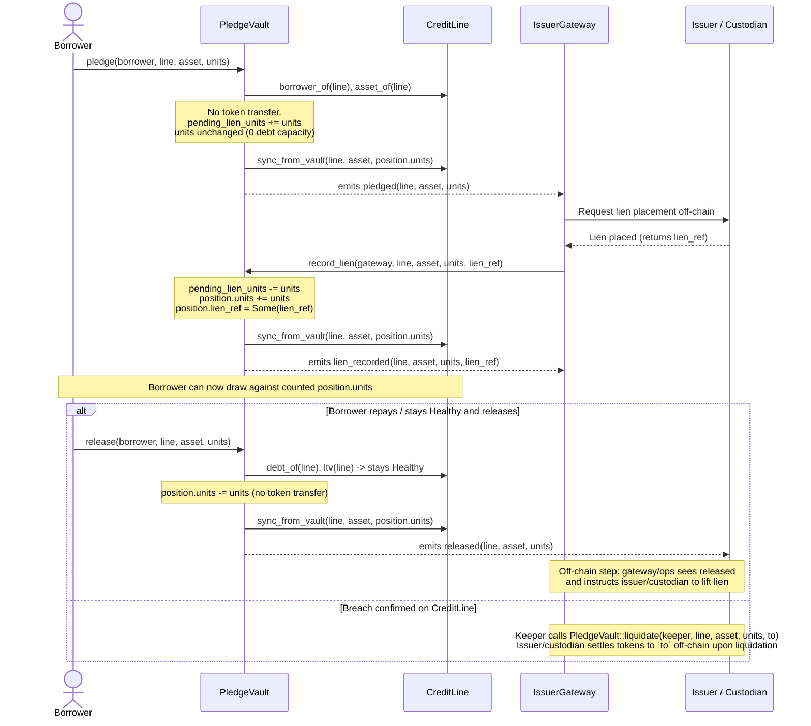

# PledgeVault

The `PledgeVault` contract tracks escrowed and lien-mode collateral positions backing lines of credit.
It enforces invariant 4: collateral is released in only two ways — `release` with healthy post-release LTV,
or `liquidate` by an authorized keeper.

## Contract Events

Every state-changing entry point publishes one event with the shape `((Symbol, line), payload)`:

| Event | Topics | Data | Emitted by |
|---|---|---|---|
| `pledged` | `(Symbol("pledged"), line: u64)` | `(asset: Address, units: i128)` | `pledge` |
| `released` | `(Symbol("released"), line: u64)` | `(asset: Address, units: i128)` | `release` |
| `lien_recorded` | `(Symbol("lien_recorded"), line: u64)` | `(asset: Address, units: i128, lien_ref: Bytes)` | `record_lien` |
| `liquidated` | `(Symbol("liquidated"), line: u64)` | `(asset: Address, units: i128, to: Address)` | `liquidate` |

## Custody Modes & Pending-Lien Flow

Every asset configured via `configure_asset` uses one of three `CustodyMode` values (`contracts/common/src/asset.rs`). Once a position holds counted or pending units (`units > 0 || pending_lien_units > 0`), its recorded `Position.mode` is locked until emptied so a mode change cannot strand escrowed tokens.

> **Note:** `CustodianLien` currently behaves identically to `IssuerLien` inside `PledgeVault`. Both use `pending_lien_units` until `record_lien` confirms placement and skip on-chain token transfers on `pledge`, `release`, and `liquidate`.

### Behavior per Function and Custody Mode

| Function | `Escrow` | `IssuerLien` | `CustodianLien` |
|---|---|---|---|
| `pledge` | Borrower signs. Transfers `units` of the RWA token from `borrower` into `PledgeVault`; credits `position.units += units` immediately; syncs `position.units` to `CreditLine`; emits `pledged`. | Borrower signs. **No token transfer.** Credits `position.pending_lien_units += units` only (`position.units` stays unchanged so pending collateral does not count toward `CreditLine` LTV); syncs `position.units` to `CreditLine`; emits `pledged`. | Same as `IssuerLien` (custodian holds tokens off-chain; credits `pending_lien_units`). |
| `record_lien` | Not used for escrow positions (fails if `units > position.pending_lien_units`, which is always `0` in `Escrow`). | Configured `gateway` signs. Moves `units` from `pending_lien_units` to `position.units`, sets `position.lien_ref = Some(lien_ref)`, syncs updated `position.units` to `CreditLine`, and emits `lien_recorded`. | Same as `IssuerLien` (gateway confirms custodian lien and moves pending to counted `units`). |
| `release` | Borrower signs. Checks `debt_of(line) == 0` or `Ok` price + `Healthy` post-release LTV via `CreditLine`; transfers `units` of RWA token back to `borrower`; decrements `position.units`; syncs to `CreditLine`; emits `released`. | Borrower signs. Runs the same zero-debt / `Healthy` post-release LTV check, decrements `position.units`, syncs to `CreditLine`, and emits `released`. **No on-chain token transfer** — the issuer must downgrade/release the trustline hold off-chain after observing `released`. | Same as `IssuerLien` (**no on-chain token transfer** — custodian must release the lien off-chain after observing `released`). |
| `liquidate` | Keeper signs (after `CreditLine::liquidate`). Transfers `units` of RWA token from `PledgeVault` to `to`; decrements `position.units` (`pending_lien_units` untouched); syncs to `CreditLine`; emits `liquidated`. | Keeper signs. Decrements `position.units` (`pending_lien_units` untouched), syncs to `CreditLine`, and emits `liquidated`. **No on-chain token transfer** — issuer clawback/delivery to `to` happens off-chain. | Same as `IssuerLien` (**no on-chain token transfer** — custodian delivers to `to` off-chain). |

### Pending-Lien Sequence (`IssuerLien` / `CustodianLien`)

### Current Limitations

- **No cancellation of `pending_lien_units`:** Once a lien-mode `pledge` adds to `pending_lien_units`, there is no on-chain entry point to cancel or decrement unconfirmed pending units if the off-chain issuer/custodian rejects or abandons the lien. Pending units never count toward `CreditLine` collateral or LTV, though they keep `Position.mode` non-empty until confirmed and released.
- **Off-chain execution required on `release` and `liquidate`:** In `IssuerLien` and `CustodianLien` modes, `PledgeVault` does not notify or invoke the issuer/custodian contract. Removing an issuer trustline hold or delivering custodian-held RWA on liquidation must be triggered off-chain by watching `released` and `liquidated` events.
- **Single `lien_ref` field ("last wins"):** Confirming a pending lien in multiple partial `record_lien` tranches accumulates all confirmed units into `position.units`, but `position.lien_ref` stores only a single `Option<Bytes>` that is overwritten on each `record_lien` call (earlier tranche references remain visible in `lien_recorded` events).
