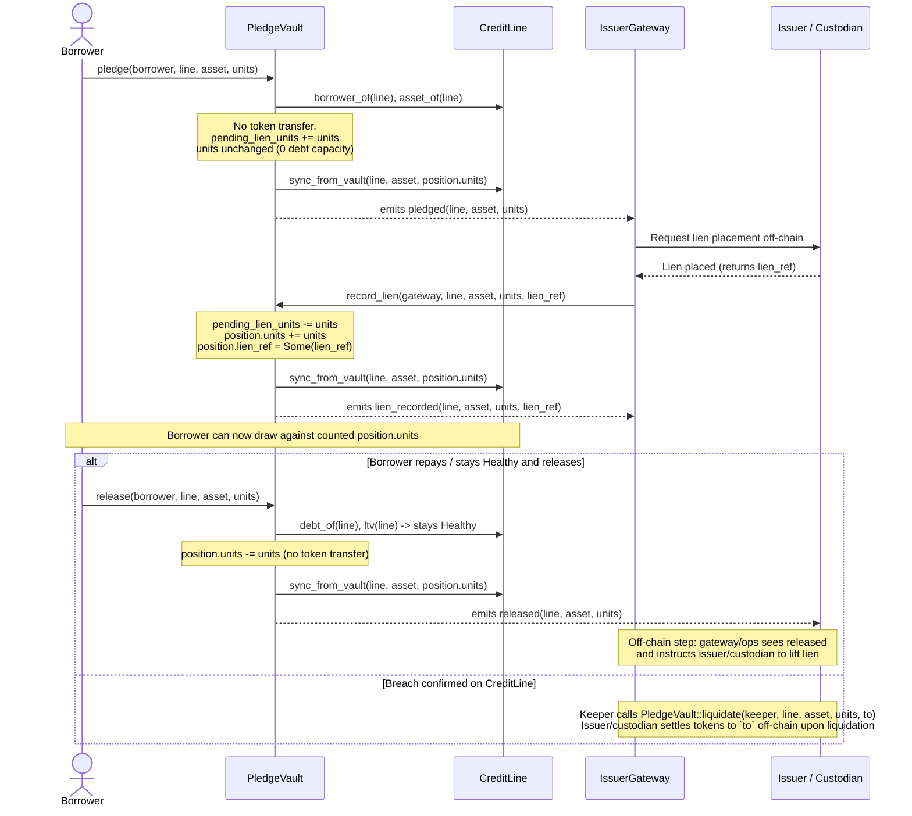

# PledgeVault

The `PledgeVault` contract tracks escrowed and lien-mode collateral positions backing lines of credit.
It enforces invariant 4: collateral is released in only two ways — `release` with healthy post-release LTV,
or `liquidate` by an authorized keeper.

## Contract Events

Every state-changing entry point publishes one event with the shape `((Symbol, line), payload)`.
See [`../EVENTS.md`](../EVENTS.md) for consumers and the payload-order compatibility rule:

| Event | Topics | Data | Emitted by |
|---|---|---|---|
| `pledged` | `(Symbol("pledged"), line: u64)` | `(asset: Address, units: i128)` | `pledge` |
| `released` | `(Symbol("released"), line: u64)` | `(asset: Address, units: i128)` | `release` |
| `lien_recorded` | `(Symbol("lien_recorded"), line: u64)` | `(asset: Address, units: i128, lien_ref: Bytes)` | `record_lien` |
| `liquidated` | `(Symbol("liquidated"), line: u64)` | `(asset: Address, units: i128, to: Address)` | `liquidate` |

## Storage layout

The table below lists the contract's `DataKey` variants and the shared role/pause keys stored by
`ballast-common`. `instance` entries share the contract instance TTL and one instance-size limit;
`persistent` entries have a separate TTL and scale independently.

### Instance storage

| Key | Tier | Written by | Read by | Growth | TTL handling | `#[contracttype]` layout note and value type |
|---|---|---|---|---|---|---|
| `AssetConfig(Address)` | Instance | `configure_asset` | `read_asset_config` (internal helper), used by `pledge`, `release`, `record_lien`, and `liquidate` | Per asset: constant-size entry per configured asset | Production entry points call `ttl::extend_instance`, except read-only `position`; threshold 17,280 ledgers, target 518,400 ledgers | `AssetConfig` struct in field order: `price_guard: Address`, `credit_line: Address`, `haircut_bps: u32`, `thresholds: MarginThresholds`, `custody_mode: CustodyMode`; `thresholds` has `warning_bps`, `margin_call_bps`, `liquidation_bps` |
| `Gateway` | Instance | `set_gateway` | `record_lien` | Constant: one configured address | Production entry points call `ttl::extend_instance`, except read-only `position` | Plain `Address` |

No pledge-vault user or position record is stored in the shared instance entry. `AssetConfig(Address)`
does grow with the number of configured assets, and asset configuration, gateway, and shared role
state share the instance entry TTL. The shared instance entry is therefore a growth and
shared-lifetime concern even though the position data is persistent.

### Persistent storage

| Key | Tier | Written by | Read by | Growth | TTL handling | `#[contracttype]` layout note and value type |
|---|---|---|---|---|---|---|
| `Position(u64, Address)` | Persistent | `pledge`, `release`, `record_lien`, and `liquidate`, through `write_position` | `read_position`, used by `pledge`, `release`, `record_lien`, `liquidate`, `position_units`, and `position`; `pledge` and `liquidate` also report units through `sync_credit_line` | Per `(line, asset)` position | Read/write helpers call `ttl::extend_persistent`; permissionless `extend_ttl(line, asset)` also keeps a live position and the instance alive | `Position` struct in field order: `units: i128`, `pending_lien_units: i128`, `mode: CustodyMode`, `lien_ref: Option<Bytes>` |

### Shared instance and persistent storage

These keys are owned by `ballast-common` and are also present in each initialized pledge-vault contract:

| Key | Tier | Written by | Read by | Growth | TTL handling | `#[contracttype]` layout note and value type |
|---|---|---|---|---|---|---|
| `RolesKey::Roles` | Instance | `initialize` / `access::write_roles`; `accept_admin` and `execute_role_change` are shared helpers that update it | `access::read_roles` and role checks used by every role-gated entry point | Constant: five role addresses | Contract entry points call `ttl::extend_instance`; role/config entries share the instance TTL | `Roles` struct in field order: `admin`, `pauser`, `keeper`, `price_publisher`, `risk` |
| `RolesKey::PendingAdmin` | Instance | Shared `access::propose_admin`; no pending-admin wrapper is exposed by `PledgeVault` itself | Shared `accept_admin` / `pending_admin` helpers; no pending-admin getter is exposed by `PledgeVault` itself | Constant: one pending proposal | Contract entry points call `ttl::extend_instance` | `PendingAdmin` struct: `new_admin: Address` |
| `RolesKey::PendingRoleChange(u64)` | Persistent | Shared `access::queue_role_change`; no role-change wrapper is exposed by `PledgeVault` itself | Shared `execute_role_change` / `pending_role_change` helpers; no role-change getter is exposed by `PledgeVault` itself | Per queued role change | Timelock-specific TTL: threshold 34,560 ledgers and target 155,520 ledgers | `PendingRoleChange` struct in field order: `role: RoleKind`, `new_address: Address`, `executes_at: u64` |
| `TimelockDataKey::NextId` | Instance | Shared `timelock::next_id`; no role-change wrapper invokes it from `PledgeVault` itself | Shared `timelock::next_id` | Constant: one monotonic counter | Contract entry points call `ttl::extend_instance` | Plain `u64` |
| `PauseDataKey::Paused(PauseScope)` | Instance | No public pause writer is exposed by `PledgeVault`; `pause::set_paused` is shared code used by contracts that expose pause entry points | `pause::is_paused` and `pause::require_not_paused`, including `pledge` | Constant per configured `PauseScope`: `Pledges`, `Draws`, `Exits`, `Repos`, `All` | Contract entry points call `ttl::extend_instance` | Plain `bool`; key enum variants are `Pledges`, `Draws`, `Exits`, `Repos`, `All` |

This pledge-vault instance storage does not contain position or user records: `Position` is a
per-`(line, asset)` persistent entry.

## TTL handling

TTL extension is implemented in current code, contrary to the original text of
[#24](https://github.com/DevTobis/ballast/issues/24). Production entry points extend instance TTL;
read-only `position` does not call `ttl::extend_instance`, because it delegates only to
`read_position`, which extends the specific persistent entry TTL. Position reads and writes also
extend the specific persistent entry TTL, and
`extend_ttl(line, asset)` keeps a live position and the instance alive. Instance and persistent
entries use shared constants of 17,280 ledgers as the threshold and 518,400 ledgers as the target,
approximately one day and 30 days respectively. Timelock entries use a 34,560-ledger threshold and
155,520-ledger target.

## Upgrade compatibility

Stored types marked `#[contracttype]` use Soroban's typed encoding. Their field and enum variant
order must not be reordered or removed without a migration: existing persistent entries can be
decoded incorrectly or fail to decode after an incompatible upgrade. This applies to `AssetConfig`,
`Position`, `CustodyMode`, `Roles`, `PendingAdmin`, `PendingRoleChange`, `RoleKind`, and
`PauseScope`.

## Custody Modes & Pending-Lien Flow

Every asset configured via `configure_asset` uses one of three `CustodyMode` values (`contracts/common/src/asset.rs`). Once a position holds counted or pending units (`units > 0 || pending_lien_units > 0`), its recorded `Position.mode` is locked until emptied so a mode change cannot strand escrowed tokens.

> **Note:** `CustodianLien` currently behaves identically to `IssuerLien` inside `PledgeVault`. Both use `pending_lien_units` until `record_lien` confirms placement and skip on-chain token transfers on `pledge`, `release`, and `liquidate`.

### Behavior per Function and Custody Mode

| Function | `Escrow` | `IssuerLien` | `CustodianLien` |
|---|---|---|---|
| `pledge` | Borrower signs. Transfers `units` of the RWA token from `borrower` into `PledgeVault`; credits `position.units += units` immediately; syncs `position.units` to `CreditLine`; emits `pledged`. | Borrower signs. **No token transfer.** Credits `position.pending_lien_units += units` only (`position.units` stays unchanged so pending collateral does not count toward `CreditLine` LTV); syncs `position.units` to `CreditLine`; emits `pledged`. | Same as `IssuerLien` (custodian holds tokens off-chain; credits `pending_lien_units`). |
| `record_lien` | Not used for escrow positions (fails if `units > position.pending_lien_units`, which is always `0` in `Escrow`). | Configured `gateway` signs. Moves `units` from `pending_lien_units` to `position.units`, sets `position.lien_ref = Some(lien_ref)`, syncs updated `position.units` to `CreditLine`, and emits `lien_recorded`. | Same as `IssuerLien` (gateway confirms custodian lien and moves pending to counted `units`). |
| `release` | Borrower signs. Checks `debt_of(line) == 0` or `Ok` price + `Healthy` post-release LTV via `CreditLine`; transfers `units` of RWA token back to `borrower`; decrements `position.units`; syncs to `CreditLine`; emits `released`. | Borrower signs. Runs the same zero-debt / `Healthy` post-release LTV check, decrements `position.units`, syncs to `CreditLine`, and emits `released`. **No on-chain token transfer** — the issuer must downgrade/release the trustline hold off-chain after observing `released`. | Same as `IssuerLien` (**no on-chain token transfer** — custodian must release the lien off-chain after observing `released`). |
| `liquidate` | Keeper signs (after `CreditLine::liquidate`). Transfers `units` of RWA token from `PledgeVault` to `to`; decrements `position.units` (`pending_lien_units` untouched); syncs to `CreditLine`; emits `liquidated`. | Keeper signs. Decrements `position.units` (`pending_lien_units` untouched), syncs to `CreditLine`, and emits `liquidated`. **No on-chain token transfer** — issuer clawback/delivery to `to` happens off-chain. | Same as `IssuerLien` (**no on-chain token transfer** — custodian delivers to `to` off-chain). |

### Pending-Lien Sequence (`IssuerLien` / `CustodianLien`)

### Current Limitations

- **No cancellation of `pending_lien_units`:** Once a lien-mode `pledge` adds to `pending_lien_units`, there is no on-chain entry point to cancel or decrement unconfirmed pending units if the off-chain issuer/custodian rejects or abandons the lien. Pending units never count toward `CreditLine` collateral or LTV, though they keep `Position.mode` non-empty until confirmed and released.
- **Off-chain execution required on `release` and `liquidate`:** In `IssuerLien` and `CustodianLien` modes, `PledgeVault` does not notify or invoke the issuer/custodian contract. Removing an issuer trustline hold or delivering custodian-held RWA on liquidation must be triggered off-chain by watching `released` and `liquidated` events.
- **Single `lien_ref` field ("last wins"):** Confirming a pending lien in multiple partial `record_lien` tranches accumulates all confirmed units into `position.units`, but `position.lien_ref` stores only a single `Option<Bytes>` that is overwritten on each `record_lien` call (earlier tranche references remain visible in `lien_recorded` events).
