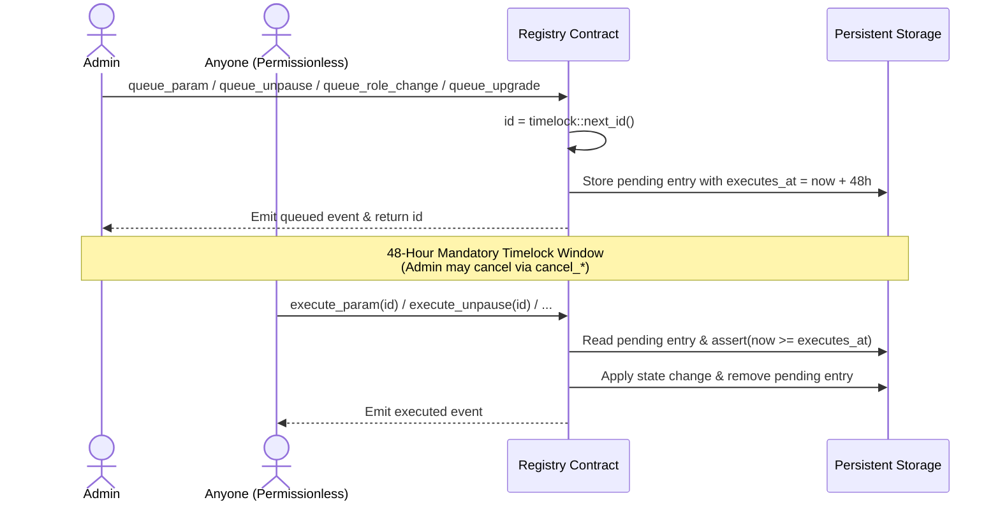

# Registry

The `Registry` contract (PRD §6.2, §8) serves as the central configuration authority for the Ballast protocol. It maintains asset configurations, haircut parameters, role addresses, pause flags, and timelocked governance changes. It holds no funds.

> [!NOTE]
> **Runtime Decoupling in Current Architecture:**
> As documented in [`ARCHITECTURE.md`](../../ARCHITECTURE.md), `Registry` is **not** read at runtime by other protocol contracts today. Consuming contracts (`CreditLine`, `PledgeVault`, `ExitDesk`, `RepoDvP`) configure their asset parameters, haircuts, and threshold copies directly via admin `configure_asset` calls (`contracts/credit-line/src/lib.rs:11`). Automating cross-contract parameter synchronization from `Registry` is planned integration work (see [Known Gaps](#known-gaps-and-open-issues)).

---

## Public Functions and Authorization

The table below documents every public entry point exposed by `Registry`, along with its caller authentication requirement, whether it is subject to the 48-hour timelock, the event emitted on execution, and its operational purpose.

| Function | Caller Auth / Role | Timelocked? | Event Emitted | Description |
|---|---|---|---|---|
| `initialize(admin, pauser, keeper, price_publisher, risk)` | First caller (unauthenticated) | No | None | One-time contract initialization; records all protocol roles. Panics if already initialized. |
| `roles()` | None (read-only) | No | None | Returns the current role addresses (`Roles`). |
| `propose_admin(new_admin)` | Stored `Admin` (`access::require_admin`) | No | None | Step 1 of two-step admin transfer. Records `new_admin` in instance storage. Can be overwritten without waiting. |
| `accept_admin()` | Proposed `new_admin` (`new_admin.require_auth()`) | No | None | Step 2 of two-step admin transfer. Consumes the proposal and updates the active admin role. |
| `pending_admin()` | None (read-only) | No | None | Returns the proposed admin address from instance storage, if a transfer is pending. |
| `queue_role_change(role, new_address)` | Stored `Admin` (`access::require_admin`) | **Yes (48h)** | None | Queues rotation for a non-admin role (`Pauser`, `Keeper`, `PricePublisher`, `Risk`). Returns monotonic change ID. |
| `execute_role_change(id)` | **Permissionless** (anyone) | **Yes (enforced)** | None | Applies a queued role rotation once its 48h delay has elapsed. Clears the pending entry. |
| `pending_role_change(id)` | None (read-only) | No | None | Returns pending role change details (`role`, `new_address`, `executes_at`), if active. |
| `register_asset(admin, asset, config)` | Stored `Admin` (`admin.require_auth()`) | **No** | `((Symbol("asset_registered"), asset), config)` | Registers a new RWA asset. Not timelocked as registering a new asset carries no existing positions or funds to protect. Cannot overwrite an existing asset. |
| `asset(asset)` | None (read-only) | No | None | Returns the stored `AssetConfig` for `asset` and extends its persistent storage TTL. |
| `queue_param(admin, asset, change)` | Stored `Admin` (`admin.require_auth()`) | **Yes (48h)** | `((Symbol("param_queued"), id), (asset, change, executes_at))` | Queues a parameter change for an already-registered asset. Validates haircut previews upfront. Returns monotonic change ID. |
| `cancel_param(admin, id)` | Stored `Admin` (`admin.require_auth()`) | No | `((Symbol("param_cancelled"), id), asset)` | Cancels a pending parameter change and removes it from storage before execution. |
| `execute_param(id)` | **Permissionless** (anyone) | **Yes (enforced)** | `((Symbol("param_executed"), id), (asset, change, config))` | Applies a queued parameter change once the 48h timelock has elapsed. Validates updated config and deletes pending entry. |
| `pending_param(id)` | None (read-only) | No | None | Returns the queued parameter change (`asset`, `change`, `executes_at`) as a `PendingParamView`, or `None` once it has been executed, cancelled or never existed. |
| `raise_haircut_now(risk, asset, add_bps)` | Stored `Risk` (`risk.require_auth()`) | **No (Emergency)** | `((Symbol("haircut_raised"), asset), (add_bps, new_haircut))` | Emergency brake: immediately raises `haircut_base_bps` without a timelock. Increase-only; total haircut capped at 10,000 bps (100%). |
| `pause(pauser, scope)` | Stored `Pauser` (`pauser.require_auth()`) | **No (Emergency)** | `((Symbol("paused"), scope), true)` | Immediately sets the pause flag for `scope` (`Pledges`, `Draws`, `Exits`, `Repos`, `All`) in `Registry` storage. |
| `queue_unpause(admin, scope)` | Stored `Admin` (`admin.require_auth()`) | **Yes (48h)** | `((Symbol("unpause_queued"), id), (scope, executes_at))` | Queues unpausing a scope. Lifting a pause is risk-loosening and requires the standard 48h notice period. Returns change ID. |
| `cancel_unpause(admin, id)` | Stored `Admin` (`admin.require_auth()`) | No | `((Symbol("unpause_cancelled"), id), scope)` | Cancels a pending unpause and removes it from storage. |
| `execute_unpause(id)` | **Permissionless** (anyone) | **Yes (enforced)** | `((Symbol("unpause_executed"), id), scope)` | Clears the pause flag for `scope` once the 48h timelock has elapsed. Deletes the pending entry. |
| `pending_unpause(id)` | None (read-only) | No | None | Returns the queued unpause (`scope`, `executes_at`) as a `PendingUnpauseView`, or `None` once it has been executed, cancelled or never existed. |
| `is_paused(scope)` | None (read-only) | No | None | Returns `true` if either `scope` or `PauseScope::All` is paused in `Registry`. |
| `queue_upgrade(admin, new_wasm_hash)` | Stored `Admin` (`admin.require_auth()`) | **Yes (48h)** | `((Symbol("queue_upgrade"), id), (new_wasm_hash, executes_at))` | Queues an in-place contract WASM bytecode upgrade. Returns change ID. |
| `cancel_upgrade(admin, id)` | Stored `Admin` (`admin.require_auth()`) | No | `((Symbol("cancel_upgrade"), id), ())` | Cancels a pending contract upgrade and removes it from storage. |
| `execute_upgrade(id)` | **Permissionless** (anyone) | **Yes (enforced)** | `((Symbol("execute_upgrade"), id), new_wasm_hash)` | Deploys new contract WASM bytecode in place once 48h has elapsed. Deletes pending entry. |
| `pending_upgrade(id)` | None (read-only) | No | None | Returns the pending contract upgrade details (`new_wasm_hash`, `executes_at`), if active. |

---

## Timelock Flow & Execution Lifecycle

Any operation that loosens risk or alters protocol governance requires a mandatory 48-hour delay (`ballast_common::timelock::TIMELOCK_DELAY_SECONDS = 172_800` seconds / ~34,560 ledgers) before it can be applied. This gives borrowers, lenders, and liquidity providers notice to evaluate changes or withdraw capital.



### Key Lifecycle Principles

1. **Shared Monotonic ID Counter:**
   - Queued changes mint monotonic IDs via `ballast_common::timelock::next_id(&env)`.
   - The counter is stored in instance storage (`TimelockDataKey::NextId`) and is **shared across all queues** within `Registry`: parameter changes, unpause requests, role rotations, and contract upgrades all share this ID space.
   - Because entries are stored under distinct storage keys (`PendingParam(id)` vs `PendingUnpause(id)` vs `PendingRoleChange(id)` vs `PendingUpgrade(id)`), queue namespaces are strictly isolated. Attempting to execute an unpause ID via `execute_param` fails with `"registry: no such pending change"`.
2. **Permissionless Execution:**
   - Authorizing a change happens during `queue_*` (which requires `Admin` authorization).
   - Once the 48-hour delay has passed, `execute_param`, `execute_unpause`, `execute_role_change`, and `execute_upgrade` are **permissionless**. Anyone (including automated keeper bots or external callers) can invoke them.
3. **Execution Grace Window & TTL Safety:**
   - Pending changes are stored in persistent storage with an initial TTL extended to cover the 48h delay plus a 7-day grace period (`TIMELOCK_EXTEND_TTL_LEDGERS = 155,520` ledgers / ~9 days).
   - If an approved change is not executed before the grace period expires, it naturally archives and cannot be executed unless refreshed.
4. **Replay Protection:**
   - Upon successful execution, the pending entry is removed from storage (`env.storage().persistent().remove(&key)`). Replaying the same change ID fails immediately.

---

## Storage Layout

The tables below detail every `DataKey` used by `Registry`, along with the shared access, timelock, and pause keys managed by `ballast-common`.

### Instance Storage

Instance storage holds global configuration and active roles that share the contract's instance TTL. Every non-read-only entry point calls `ttl::extend_instance(&env)` to ensure the contract instance never archives.

| Key | Tier | Written by | Read by | Growth | TTL Handling | Value Type & Notes |
|---|---|---|---|---|---|---|
| `RolesKey::Roles` | Instance | `initialize`, `accept_admin`, `execute_role_change` | `roles`, all role-checked entry points | Constant | Threshold: 17,280 ledgers<br/>Target: 518,400 ledgers (~30 days) | `Roles` struct: `admin`, `pauser`, `keeper`, `price_publisher`, `risk` (all `Address`) |
| `RolesKey::PendingAdmin` | Instance | `propose_admin` | `accept_admin`, `pending_admin` | Constant (at most one pending) | Instance TTL | `PendingAdmin` struct: `new_admin: Address` |
| `TimelockDataKey::NextId` | Instance | `timelock::next_id` | `queue_param`, `queue_unpause`, `queue_role_change`, `queue_upgrade` | Constant (one monotonic counter) | Instance TTL | Plain `u64` |
| `PauseDataKey::Paused(PauseScope)` | Instance | `pause`, `execute_unpause` | `is_paused` | Constant per scope (`Pledges`, `Draws`, `Exits`, `Repos`, `All`) | Instance TTL | Plain `bool` |

### Persistent Storage

Individual asset configurations and transient timelock queue items live in persistent storage so they scale independently of the contract instance.

| Key | Tier | Written by | Read by | Growth | TTL Handling | Value Type & Notes |
|---|---|---|---|---|---|---|
| `DataKey::Asset(Address)` | Persistent | `register_asset`, `execute_param`, `raise_haircut_now` | `asset`, `queue_param`, `execute_param`, `raise_haircut_now` | Per registered asset | Threshold: 17,280 ledgers<br/>Target: 518,400 ledgers (~30 days) | `AssetConfig` struct: `issuer`, `contract`, `standard`, `yield_type`, `custody_mode`, `ccy`, `redemption_lag_days`, `haircut_base_bps`, `haircut_fx_bps`, `price_band_bps`, `daily_move_band_bps`, `status` |
| `DataKey::PendingParam(u64)` | Persistent | `queue_param` | `cancel_param`, `execute_param`, `pending_param` | Per queued parameter change | Timelock TTL:<br/>Threshold: 34,560 ledgers<br/>Target: 155,520 ledgers (~9 days) | `PendingParamChange` struct: `asset: Address`, `change: ParamChange`, `executes_at: u64`. Deleted on execute/cancel. |
| `DataKey::PendingUnpause(u64)` | Persistent | `queue_unpause` | `cancel_unpause`, `execute_unpause`, `pending_unpause` | Per queued unpause | Timelock TTL:<br/>Threshold: 34,560 ledgers<br/>Target: 155,520 ledgers (~9 days) | `PendingUnpause` struct: `scope: PauseScope`, `executes_at: u64`. Deleted on execute/cancel. |
| `RolesKey::PendingRoleChange(u64)` | Persistent | `queue_role_change` | `execute_role_change`, `pending_role_change` | Per queued role rotation | Timelock TTL:<br/>Threshold: 34,560 ledgers<br/>Target: 155,520 ledgers | `PendingRoleChange` struct: `role: RoleKind`, `new_address: Address`, `executes_at: u64`. Deleted on execute. |
| `UpgradeKey::PendingUpgrade(u64)` | Persistent | `queue_upgrade` | `cancel_upgrade`, `execute_upgrade`, `pending_upgrade` | Per queued contract upgrade | Timelock TTL:<br/>Threshold: 34,560 ledgers<br/>Target: 155,520 ledgers | `PendingUpgrade` struct: `new_wasm_hash: BytesN<32>`, `executes_at: u64`. Deleted on execute/cancel. |

> [!IMPORTANT]
> **Why Pending Changes Live in Persistent Storage (Not Temporary Storage):**
> Conceptually, pending queue items represent transient, short-lived records. However, in Soroban, entries in the `temporary` storage tier can be evicted unexpectedly before the 48-hour timelock delay elapses if network storage pressure is high. To ensure queued governance actions reliably survive the full 48-hour review window and the 7-day execution grace period, Ballast explicitly places them in persistent storage with `timelock::extend_entry_ttl`. Entries are purged upon execution or cancellation.

---

## Protocol Invariants

1. **Combined Haircut Ceiling:**
   - The total asset haircut (`haircut_base_bps + haircut_fx_bps`) must never exceed `10_000` bps (100%).
   - Enforced by `AssetConfig::validate` during `register_asset` and `execute_param`, and previewed in `queue_param`.
2. **Emergency Haircut Raise Invariants:**
   - Callable strictly by the `Risk` role (`raise_haircut_now`).
   - **Increase-only:** `new_haircut = haircut_base_bps.checked_add(add_bps)`. It can only tighten risk, never loosen it.
   - Enforces `new_haircut + haircut_fx_bps <= 10_000` bps.
   - Any reduction in haircut (loosening risk) **must** go through the 48-hour timelocked `queue_param` path.
3. **Asset Registration Immutability:**
   - `register_asset` is un-timelocked so new assets can be onboarded quickly.
   - Once registered, an asset address cannot be re-registered or overwritten (`assert!(!env.storage().persistent().has(&DataKey::Asset(asset)))`). Subsequent changes must go through `queue_param`.
4. **Role Segregation:**
   - The `Pauser` can only `pause` (immediate stop). Pauser cannot unpause, register assets, or modify parameters.
   - The `Risk` role can only `raise_haircut_now`. Risk cannot decrease haircuts or pause scopes.
   - The `Admin` can queue parameter changes, unpauses, role rotations, and upgrades, but cannot bypass the 48-hour notice window.
5. **Freeze-After-Audit Upgrade Policy:**
   - Pre-audit upgrades allow updating logic in place without state loss. Post-audit, upgrade authority will be permanently renounced/burned to guarantee protocol immutability.

---

## Example CLI Invocations (Testnet)

The following commands demonstrate how to interact with `Registry` using the `stellar` CLI. These examples match the conventions used in `scripts/deploy.sh` and run against testnet unchanged.

### 1. Initialize Registry Roles
```bash
stellar contract invoke \
  --id "$REGISTRY_CID" \
  --source admin \
  --network testnet -- \
  initialize \
  --admin "$ADMIN" \
  --pauser "$PAUSER" \
  --keeper "$KEEPER" \
  --price_publisher "$PRICE_PUBLISHER" \
  --risk "$RISK"
```

### 2. Register a New Asset (Immediate, Admin Only)
```bash
stellar contract invoke \
  --id "$REGISTRY_CID" \
  --source admin \
  --network testnet -- \
  register_asset \
  --admin "$ADMIN" \
  --asset "$RWA_SAC" \
  --config '{"issuer":"'"$RWA_ISSUER"'","contract":"'"$RWA_SAC"'","standard":"ClassicSac","yield_type":"Accumulating","custody_mode":"Escrow","ccy":"USD","redemption_lag_days":1,"haircut_base_bps":500,"haircut_fx_bps":0,"price_band_bps":50,"daily_move_band_bps":100,"status":"active"}'
```

### 3. Read Stored Asset Configuration (Permissionless)
```bash
stellar contract invoke \
  --id "$REGISTRY_CID" \
  --source admin \
  --network testnet -- \
  asset \
  --asset "$RWA_SAC"
```

### 4. Queue a Parameter Change (Admin Only, 48h Timelock)
```bash
# Queue base haircut change to 600 bps (6%). Returns change ID (e.g., 0).
stellar contract invoke \
  --id "$REGISTRY_CID" \
  --source admin \
  --network testnet -- \
  queue_param \
  --admin "$ADMIN" \
  --asset "$RWA_SAC" \
  --change '{"HaircutBaseBps":600}'
```

### 5. Execute Queued Parameter Change After 48h (Permissionless)
```bash
# Note: Execution is permissionless; any funded account (e.g. keeper) can execute once the timelock has elapsed.
stellar contract invoke \
  --id "$REGISTRY_CID" \
  --source keeper \
  --network testnet -- \
  execute_param \
  --id "$CHANGE_ID"
```

### 6. Emergency Haircut Raise (Risk Only, Immediate)
```bash
# Immediately add 200 bps to haircut_base_bps
stellar contract invoke \
  --id "$REGISTRY_CID" \
  --source risk \
  --network testnet -- \
  raise_haircut_now \
  --risk "$RISK" \
  --asset "$RWA_SAC" \
  --add_bps 200
```

### 7. Emergency Pause (Pauser Only, Immediate)
```bash
# Immediately pause Draws
stellar contract invoke \
  --id "$REGISTRY_CID" \
  --source pauser \
  --network testnet -- \
  pause \
  --pauser "$PAUSER" \
  --scope '"Draws"'
```

### 8. Queue and Execute Unpause (48h Timelock)
```bash
# 1. As admin: queue the unpause
stellar contract invoke \
  --id "$REGISTRY_CID" \
  --source admin \
  --network testnet -- \
  queue_unpause \
  --admin "$ADMIN" \
  --scope '"Draws"'

# 2. After 48h: execute unpause (permissionless; any funded account, e.g. keeper)
stellar contract invoke \
  --id "$REGISTRY_CID" \
  --source keeper \
  --network testnet -- \
  execute_unpause \
  --id "$UNPAUSE_ID"
```

### 9. Rotate a Non-Admin Role (48h Timelock)
```bash
# 1. As admin: queue new pauser address
stellar contract invoke \
  --id "$REGISTRY_CID" \
  --source admin \
  --network testnet -- \
  queue_role_change \
  --role '"Pauser"' \
  --new_address "$NEW_PAUSER"

# 2. After 48h: execute rotation (permissionless; any funded account, e.g. keeper)
stellar contract invoke \
  --id "$REGISTRY_CID" \
  --source keeper \
  --network testnet -- \
  execute_role_change \
  --id "$ROLE_CHANGE_ID"

# 3. Inspect updated roles
stellar contract invoke \
  --id "$REGISTRY_CID" \
  --source admin \
  --network testnet -- \
  roles
```

---

## Known Gaps and Open Issues

1. **Runtime Decoupling across Protocol Contracts:**
   - Consuming contracts (`CreditLine`, `PledgeVault`, `ExitDesk`, `RepoDvP`) configure asset parameters and risk settings directly via local admin `configure_asset` calls rather than cross-calling `Registry::asset` at runtime.
   - Synchronizing all protocol contracts dynamically from `Registry` is tracked as open architecture work (`ARCHITECTURE.md:59`).
2. **Registry Pause Decoupling:**
   - `Registry::pause` and `is_paused` manage pause flags in `Registry`'s instance storage. However, operating contracts currently evaluate pause gates against their own local pause storage (`contracts/common/src/pause.rs:41`).
   - `RepoDvP` exposes its own pause/unpause writer, while `ExitDesk` pause integration is decoupled from Registry pause storage.
3. **`repo-dvp::propose` Ungated:**
   - `RepoDvP::propose` is currently ungated even though documentation specifies that new repo activity should be subject to `PauseScope::Repos` (#846).
4. **Soroban Event Deprecation:**
   - Events are published using `env.events().publish(...)`, which is deprecated in newer `soroban-sdk` releases in favor of the `#[contractevent]` macro.
