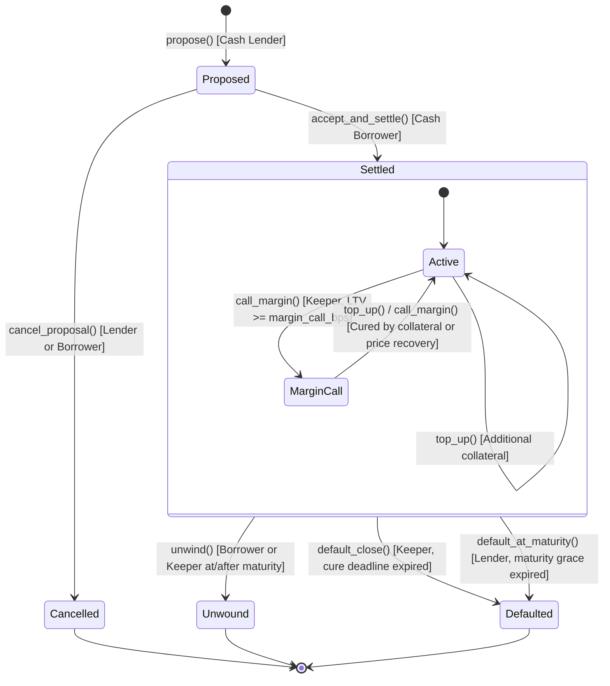

# RepoDvP

`RepoDvP` executes bilateral fixed-term and open repurchase agreements (repos) for tokenised Real-World Assets (RWAs) against USDC, with atomic Delivery-versus-Payment (DvP) settlement, mark-to-market margin tracking, and automated default procedures (PRD §6.2, §8).

See [AUDIT_NOTES.md](../AUDIT_NOTES.md) for auditor notes, trust assumptions, and security invariants.

---

## Trade Lifecycle

Trades transition strictly through the following states:

### State Transitions
1. **`Proposed`**: Cash lender specifies terms (`asset`, `units`, `cash_amount`, `rate_bps`, `kind`, `maturity_at`, `agreement_hash`). The lender's USDC allowance is granted to the contract.
2. **`Cancelled`**: Lender or borrower cancels an unaccepted proposal. Lender's pre-authorised allowance is zeroed.
3. **`Settled`**: Borrower accepts and deposits RWA collateral into the contract; USDC is transferred atomically from lender to borrower (Leg 1).
4. **`Unwound`**: Borrower pays back principal + accrued interest to lender; contract returns RWA collateral to borrower (Leg 2). Keeper may execute this on borrower's behalf if pre-approved.
5. **`Defaulted`**: If borrower fails to cure an open margin call before `cure_deadline`, or fails to unwind after `maturity_at + maturity_grace`, the collateral is liquidated to the lender at the guarded price (no haircut) with any surplus returned to the borrower.

---

## Cash-Leg Authorisation Model

To prevent escrow lockup and avoid custodial risk for cash:
- **No Escrowed USDC**: Neither lender nor borrower deposits USDC into the contract prior to trade settlement or unwind.
- **Pre-authorisation via Stellar Asset Contract (SAC) Allowances**:
  - **Leg 1 (`propose`)**: The cash lender calls `propose`, which approves a SAC allowance on their USDC balance in favor of `RepoDvP`. When the borrower calls `accept_and_settle`, `RepoDvP` transfers USDC directly from the lender to the borrower via `transfer_from`.
  - **Leg 2 (`accept_and_settle`)**: The borrower approves an allowance in favor of `RepoDvP` covering principal plus maximum expected interest. On `unwind`, `RepoDvP` transfers USDC directly from borrower to lender.
- **Idempotence & Replacement**: Proposing a new repo replaces any previous unaccepted proposal allowance for that `(lender, token)` pair.

---

## Margin and Default Mathematics

### 1. Interest Accrual
Interest accrues linearly (simple, non-compounding) per second based on the agreed `rate_bps`:
$$\text{elapsed} = \text{timestamp} - \text{settled\_at}$$
$$\text{interest} = \frac{\text{cash\_amount} \times \text{rate\_bps} \times \text{elapsed}}{10{,}000 \times 365 \times 86{,}400}$$
$$\text{total\_exposure} = \text{cash\_amount} + \text{interest}$$

### 2. Collateral Valuation
Collateral is valued at the `PriceGuard` price with an asset-specific haircut applied:
$$\text{collateral\_value} = \frac{\text{units} \times \text{guarded\_price} \times (10{,}000 - \text{haircut\_bps})}{10{,}000 \times \text{PRICE\_SCALE}}$$

### 3. Loan-to-Value (LTV)
$$\text{LTV (bps)} = \frac{\text{total\_exposure} \times 10{,}000}{\text{collateral\_value}}$$

### 4. Margin State Classification
Based on the configured asset `MarginThresholds` (`warning_bps < margin_call_bps < liquidation_bps`):
- **Healthy**: $\text{LTV} < \text{warning\_bps}$
- **Warning**: $\text{warning\_bps} \le \text{LTV} < \text{margin\_call\_bps}$
- **MarginCall**: $\text{margin\_call\_bps} \le \text{LTV} < \text{liquidation\_bps}$ (Keeper opens call; sets `cure_deadline = now + cure_grace`)
- **Liquidation**: $\text{LTV} \ge \text{liquidation\_bps}$

### 5. Default Liquidation Settlement
On default (`default_close` or `default_at_maturity`), collateral is valued at the guarded spot price with **no haircut** ($0\%$):
$$\text{lender\_units} = \min\left(\text{pledged\_units}, \left\lceil \frac{\text{total\_exposure} \times \text{PRICE\_SCALE}}{\text{guarded\_price}} \right\rceil\right)$$
$$\text{borrower\_surplus} = \text{pledged\_units} - \text{lender\_units}$$
- If collateral is insufficient to cover exposure, lender takes 100% of collateral and bears the shortfall.
- No USDC is transferred during default.

---

## Entry Points Reference

| Function | Caller | Preconditions | Pause Gated? | Emitted Event |
|---|---|---|---|---|
| `initialize` | Any | Initialises admin, pauser, keeper, price_publisher, risk roles | No | — |
| `set_usdc` | `admin` | Admin auth | No | `(symbol_short!("usdc"),)` |
| `set_cure_grace` | `admin` | Admin auth; `seconds >= 3600` | No | `(symbol_short!("curegrace"),)` |
| `cure_grace_seconds` | Anyone | Read-only | No | — |
| `set_maturity_grace` | `admin` | Admin auth; `seconds >= 3600` | No | — |
| `maturity_grace_seconds` | Anyone | Read-only | No | — |
| `pause` | `pauser` | Pauser auth | No | `(Symbol("paused"), scope)` |
| `queue_unpause` | `admin` | Admin auth; 48-hour timelock | No | `(Symbol("unpause_queued"), id)` |
| `cancel_unpause` | `admin` | Admin auth | No | `(Symbol("unpause_cancelled"), id)` |
| `execute_unpause` | Anyone | Timelock elapsed | No | `(Symbol("unpause_executed"), id)` |
| `is_paused` | Anyone | Read-only | No | — |
| `configure_asset` | `admin` | Admin auth; valid thresholds and haircut $\le 10{,}000$ | No | `(symbol_short!("cfgasset"), asset)` |
| `disable_asset` | `admin` | Admin auth | No | `(symbol_short!("disable"), asset)` |
| `enable_asset` | `admin` | Admin auth | No | `(symbol_short!("enable"), asset)` |
| `is_asset_enabled` | Anyone | Read-only | No | — |
| `propose` | `cash_lender` | Lender auth; asset enabled; valid rate, term, units, cash | No | `(symbol_short!("propose"), id)` |
| `cancel_proposal` | Lender/Borrower | Caller is lender or borrower; status is `Proposed` | No | `(symbol_short!("cancel"), id)` |
| `accept_and_settle` | `cash_borrower` | Borrower auth; status is `Proposed`; before maturity; asset enabled | **Yes (`Repos` / `All`)** | `(symbol_short!("settle"), id)` |
| `unwind` | Borrower/Keeper | Caller is borrower or keeper; status is `Settled`; $\ge \text{maturity\_at}$ | **No** (Risk reduction) | `(symbol_short!("unwind"), id)` |
| `call_margin` | `keeper` | Keeper auth; status is `Settled`; price usable | **No** (Risk monitoring) | `(symbol_short!("mcall"), id)` or `(symbol_short!("cured"), id)` |
| `top_up` | `cash_borrower` | Borrower auth; status is `Settled`; `extra_units > 0` | **No** (Collateral top-up) | `(symbol_short!("topup"), id)` |
| `default_close` | `keeper` | Keeper auth; status is `Settled`; margin call open and expired; price usable | **No** (Liquidation) | `(symbol_short!("default"), id)` |
| `default_at_maturity` | `cash_lender` | Lender auth; status is `Settled`; $\text{now} \ge \text{maturity\_at} + \text{grace}$; price usable | **No** (Liquidation) | `(symbol_short!("mat_def"), id)` |
| `margin_view` | Anyone | Read-only simulated margin evaluation | No | — |
| `trade` | Anyone | Read-only trade record query | No | — |
| `extend_ttl` | Anyone | Permissionless keep-alive extending trade and instance TTL | No | — |

---

## Failure Modes & Panic Messages

| Panic Message | Cause | Resolution |
|---|---|---|
| `repo-dvp: caller is not cash_borrower` | Non-borrower tried to call `accept_and_settle` or unauthorized caller invoked borrower-restricted entry point | Ensure caller address matches `trade.cash_borrower` and signed transaction |
| `repo-dvp: only the cash lender can default at maturity` | Non-lender invoked `default_at_maturity` | Only the trade's `cash_lender` may trigger maturity default |
| `repo-dvp: proposal has matured` | `accept_and_settle` attempted after `trade.maturity_at` | Accept trade before proposed maturity timestamp |
| `repo-dvp: trade is not settled` | Unwind, margin call, or default invoked on a proposal that was never settled | Verify trade status is `Settled` |
| `repo-dvp: trade has not matured` | `unwind` invoked prior to `maturity_at` | Await trade maturity before initiating unwind |
| `repo-dvp: maturity grace has not ended` | `default_at_maturity` called before `maturity_at + maturity_grace_seconds` | Wait until full maturity grace window expires |
| `repo-dvp: cannot default an unwound trade` | Default invoked on already unwound trade | Verify trade status before submitting default |
| `repo-dvp: cure window has not ended` | `default_close` called before `cure_deadline` | Allow borrower full cure window to post top-up collateral |
| `repo-dvp: position has recovered, cannot default` | Collateral price recovered or position topped up before default call | Margin call has cured; default cannot proceed |
| `repo-dvp: price is not usable` | `PriceGuard` returned `Degraded` or `Halted` status | Await price recovery or unhalt by risk role |
| `repo-dvp: asset is disabled` | `propose` or `accept_and_settle` called on disabled asset | Use active, enabled asset |
| `repo-dvp: rate_bps exceeds the maximum rate` | `rate_bps > 10_000` (100% per annum) in `propose` | Keep repo rate within allowable protocol bounds ($\le 10{,}000$ bps) |
| `repo-dvp: an intraday repo must mature within 24 hours` | Term exceeds 24h for `RepoKind::Intraday` | Ensure maturity is within 86,400 seconds of proposal |
| `repo-dvp: an overnight repo must mature within 48 hours` | Term exceeds 48h for `RepoKind::Overnight` | Ensure maturity is within 172,800 seconds of proposal |
| `repo-dvp: a term/open repo must mature within 30 days` | Term exceeds 30 days for `RepoKind::Term` or `RepoKind::Open` | Set maturity date within 30-day limit |
| `ballast-common: paused` | Action attempted while pause scope `Repos` or `All` is active | Await admin timelocked unpause execution |
