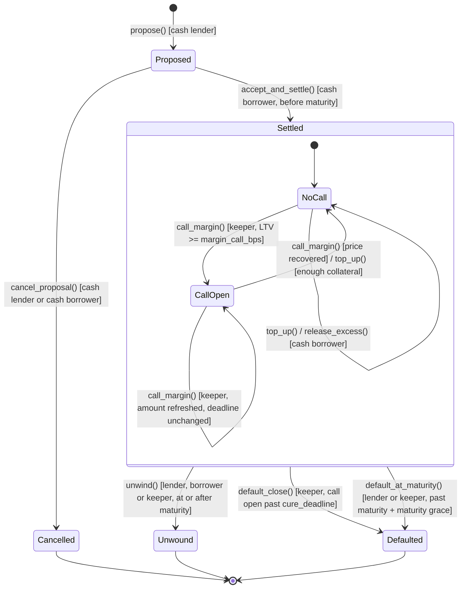

# RepoDvP

The `RepoDvP` contract provides bilateral repos of Real World Asset (RWA) tokens against USDC on Stellar via Soroban with atomic Delivery-versus-Payment (DvP) on leg 1 and scheduled unwind on leg 2 (PRD §5 Phase 3, §8).

## Architecture & Settlement Lifecycle

1. **Proposal**: A cash lender calls `propose` with terms (units, cash amount, interest rate in bps, maturity, agreement hash). The lender pre-authorizes the leg-1 cash transfer via an allowance.
2. **Settlement (Leg 1)**: The cash borrower calls `accept_and_settle`. RWA collateral is escrowed into the contract, USDC is transferred directly from lender to borrower, and leg 2 repayment allowance is pre-authorized.
3. **Margin Monitoring & Top-up**: While settled, positions can be monitored against price fluctuations via `call_margin`. If undercollateralized, a margin call opens with a cure grace deadline. Borrowers can cure by topping up collateral via `top_up` or via price recovery.
4. **Unwind (Leg 2)**: At or past maturity, `unwind` transfers total cash due (principal + interest) to the lender and releases escrowed collateral back to the borrower.
5. **Default**:
   - `default_close`: If a margin call expires uncured, the keeper defaults the trade, transferring collateral to the lender up to exposure and returning surplus to the borrower.
   - `default_at_maturity`: If an unpaid trade remains past `maturity_at + maturity_grace`, the lender or keeper defaults the trade.

---

## Contract Events

The trade-lifecycle entry points publish events with the shape `((Symbol, id), payload)`, listed
below. The asset toggles (`disable`, `enable`, keyed by the asset) and the pause events
(`paused`, `unpause_queued`, `unpause_cancelled`, `unpause_executed`) are listed with their exact
shapes in [`../EVENTS.md`](../EVENTS.md). Admin events are in the second table below.

| Event | Topics | Data | Emitted by | Description |
|---|---|---|---|---|
| `propose` | `(Symbol("propose"), id: u64)` | `(cash_lender: Address, cash_borrower: Address, asset: Address, units: i128, cash_amount: i128, maturity_at: u64)` | `propose` | Published when a new repo trade proposal is created. |
| `cancel` | `(Symbol("cancel"), id: u64)` | `caller: Address` | `cancel_proposal` | Published when a pending proposal is cancelled by the lender or borrower. |
| `settle` | `(Symbol("settle"), id: u64)` | `units: i128` | `accept_and_settle` | Published when the borrower accepts and settles leg 1 of the trade. |
| `unwind` | `(Symbol("unwind"), id: u64)` | `total_due: i128` | `unwind` | Published when leg 2 unwinds successfully at or past maturity. |
| `mcall` | `(Symbol("mcall"), id: u64)` | `margin_call_amount: i128` | `call_margin` | Published when a trade's collateral breaches the margin call threshold. |
| `cured` | `(Symbol("cured"), id: u64)` | `0i128` | `call_margin` | Published when an open margin call is cured via price recovery. |
| `topup` | `(Symbol("topup"), id: u64)` | `(units: i128, cured: bool)` | `top_up` | Published when the borrower adds collateral to top up a trade. |
| `release` | `(Symbol("release"), id: u64)` | `units: i128` | `release_excess` | Published when the borrower takes back excess collateral; the LTV after the release stays under `warning_bps`. |
| `default` | `(Symbol("default"), id: u64)` | `(lender_units: i128, borrower_units: i128)` | `default_close` | Published when an uncured margin call is defaulted by the keeper. |
| `mat_def` | `(Symbol("mat_def"), id: u64)` | `(lender_units: i128, borrower_units: i128)` | `default_at_maturity` | Published when an unpaid trade past maturity grace is defaulted. |

### Admin events

Admin changes publish the new value (and the old one where it is cheap to read), so an auditor or
the ledger service can see when a risk parameter changed without diffing storage:

| Event | Topics | Data | Emitted by | Description |
|---|---|---|---|---|
| `usdc` | `(Symbol("usdc"),)` | `(old_usdc: Option<Address>, new_usdc: Address)` | `set_usdc` | Cash-leg token set or changed. `old_usdc` is `None` on the first call. |
| `curegrace` | `(Symbol("curegrace"),)` | `(old_seconds: u64, new_seconds: u64)` | `set_cure_grace` | Margin-call cure window changed (applies to calls opened from then on). |
| `matgrace` | `(Symbol("matgrace"),)` | `(old_seconds: u64, new_seconds: u64)` | `set_maturity_grace` | Grace after maturity before `default_at_maturity` can act. |
| `cfgasset` | `(Symbol("cfgasset"), asset: Address)` | `(price_guard: Address, haircut_bps: u32, thresholds: MarginThresholds, max_cash_per_trade: i128, max_term_seconds: u64)` | `configure_asset` | Asset risk parameters set; the payload is the full new config. |
| `cfg_q` | `(Symbol("cfg_q"), id: u64)` | `(asset: Address, config: RepoAssetConfig, executes_at: u64)` | `queue_asset_config` | A config change queued behind the 48h timelock (#215). |
| `cfg_exec` | `(Symbol("cfg_exec"), id: u64)` | `asset: Address` | `execute_asset_config` | Queued config applied; a `cfgasset` with the new config is published in the same call. |
| `cfg_canc` | `(Symbol("cfg_canc"), id: u64)` | `asset: Address` | `cancel_asset_config` | Queued config dropped. |

`tighten_asset_config` (risk role) publishes the same `cfgasset` event as `configure_asset`.

## Changing an asset's configuration (48h timelock, #215)

| Change | Path |
|---|---|
| First listing of the asset | `configure_asset` (admin), immediate |
| Same values, a higher haircut, lower thresholds, a lower `max_cash_per_trade` or `max_term_seconds` | `configure_asset` (admin), immediate |
| A higher haircut and/or lower thresholds, keeping guard and caps | `tighten_asset_config` (risk), immediate |
| A different `price_guard`, a lower haircut, any higher threshold or cap | `queue_asset_config` (admin), then `execute_asset_config` (anyone) after 48h; `cancel_asset_config` (admin) until then |

If a change touches several fields and any one of them loosens, the whole change is timelocked, and
`configure_asset` refuses it with `repo-dvp: change loosens the asset config; use queue_asset_config`.
The queued config is a full replacement: it overwrites whatever the asset has when it executes,
including tightening applied in the meantime. `scripts/configure-desks.sh` queues the switch when
the asset already reads a different PriceGuard, and `scripts/e2e-repo-margin.sh` queues its threshold
restore.

---

## Trade lifecycle

- **Proposed.** The cash lender fixes the terms (`cash_borrower`, `asset`, `units`, `cash_amount`,
  `rate_bps`, `kind`, `maturity_at`, `agreement_hash`) and approves this contract to spend
  `cash_amount` of its USDC (leg 1).
- **Cancelled.** Either party cancels a proposal that has not settled. A lender cancelling its
  latest proposal also resets its leg-1 allowance to zero; a borrower cancelling cannot touch the
  lender's allowance, so it stays until the lender's next `propose` replaces it or it expires.
- **Settled.** The borrower accepts before `maturity_at`: the RWA moves into this contract and the
  USDC moves from the lender to the borrower in the same call (leg 1).
- **Unwound.** At or after maturity the borrower pays principal plus interest to the lender and gets
  the RWA back (leg 2). The lender or the keeper may trigger it; they spend the borrower's leg-2
  allowance.
- **Defaulted.** No USDC moves. The RWA is split at the guarded price with no haircut; see
  [Default settlement](#default-settlement).

## Cash-leg authorisation

No USDC is ever held by this contract. Both legs pay wallet to wallet out of token allowances that
the paying party grants in a call it signs:

- **Leg 1.** `propose` has the lender approve this contract for `cash_amount`; `accept_and_settle`
  spends it with `transfer_from`. One live proposal per (lender, token): an allowance is a single
  number, so a lender's second `propose` replaces the first one's allowance.
- **Leg 2.** `accept_and_settle` has the borrower approve this contract for the **sum of that
  borrower's outstanding leg-2 dues** across all their settled trades (each trade's principal plus
  interest from settlement to maturity), valid until at least `UNWIND_ALLOWANCE_GRACE_LEDGERS` past
  maturity. The sum is tracked per borrower, added on settle and released on `unwind` /
  `default_close`, so one trade's re-approval never strands another trade's unwind. A non-borrower
  `unwind` spends that trade's share with `transfer_from`.

## Margin and default maths

All values use 7 decimals (`PRICE_SCALE = 10_000_000`) and floor division.

- **Interest** is simple and linear: `cash_amount * rate_bps * elapsed / (365 * 86_400) / 10_000`.
  For margin (`call_margin`, `top_up`, `release_excess`, `margin_view`) `elapsed` runs from
  settlement to now, capped at `maturity_at`. Leg 2 (`unwind`, `default_at_maturity`) charges the
  full term from settlement to maturity.
- **Exposure** = `cash_amount + interest`.
- **Collateral value** = `units * guarded_price / PRICE_SCALE * (10_000 - haircut_bps) / 10_000`.
- **LTV (bps)** = `exposure * 10_000 / collateral_value`, classified against the asset's
  `MarginThresholds` (`warning_bps < margin_call_bps < liquidation_bps`): Healthy below warning,
  Warning, MarginCall from `margin_call_bps`, Liquidation from `liquidation_bps`.
- **Margin call amount**: when the state is MarginCall or Liquidation, `call_margin` sets
  `margin_call_amount = exposure * 10_000 / margin_call_bps - collateral_value` (the collateral
  value still missing to get back to the margin-call threshold). The first call sets
  `cure_deadline = now + cure_grace` (default 24h, admin-set, at least 60s); later calls refresh
  the amount but never move the deadline.
- **Release.** `release_excess` is allowed only while the LTV after the release stays below
  `warning_bps`.

### Default settlement

`default_close` and `default_at_maturity` value the pledged RWA at the guarded price with **no
haircut**. The lender receives `ceil(owed * PRICE_SCALE / price)` units, capped at what is pledged,
and the rest goes back to the borrower. `owed` is the margin exposure for `default_close` and the
full leg-2 `total_due` for `default_at_maturity`. If the collateral is worth less than what is
owed, the lender takes all of it and bears the shortfall.

## Entry points

| Function | Caller | Preconditions | Pause-gated | Event |
|---|---|---|---|---|
| `initialize` | anyone, once | not yet initialized; records admin, pauser, keeper, price publisher, risk | no | none |
| `set_usdc` | admin | | no | `usdc` |
| `set_cure_grace` | admin | `seconds >= 60` | no | `curegrace` |
| `set_maturity_grace` | admin | `seconds >= 60` | no | `matgrace` |
| `cure_grace_seconds`, `maturity_grace_seconds` | anyone | read-only | no | none |
| `configure_asset` | admin | valid haircut, ordered thresholds, positive caps; refuses loosening an existing config | no | `cfgasset` |
| `tighten_asset_config` | risk | asset configured; refuses loosening | no | `cfgasset` |
| `queue_asset_config` | admin | asset configured; valid config | no | `cfg_q` |
| `execute_asset_config` | anyone | 48h elapsed | no | `cfgasset`, `cfg_exec` |
| `cancel_asset_config` | admin | pending | no | `cfg_canc` |
| `pending_asset_config`, `asset_config` | anyone | read-only | no | none |
| `disable_asset`, `enable_asset` | admin | | no | `disable`, `enable` |
| `is_asset_enabled` | anyone | read-only | no | none |
| `pause` | pauser | | no | `paused` |
| `queue_unpause` | admin | | no | `unpause_queued` |
| `cancel_unpause` | admin | pending | no | `unpause_cancelled` |
| `execute_unpause` | anyone | 48h elapsed | no | `unpause_executed` |
| `is_paused` | anyone | read-only | no | none |
| `propose` | cash lender | asset enabled and configured; positive units and cash; future maturity; term fits `kind`; `rate_bps <= 10_000`; within the asset's cash and term caps | no (#846) | `propose` |
| `cancel_proposal` | cash lender or cash borrower | status `Proposed` | no | `cancel` |
| `accept_and_settle` | cash borrower | status `Proposed`; before maturity; asset enabled; within caps | **yes** (`Repos` / `All`) | `settle` |
| `unwind` | cash lender, cash borrower or keeper | status `Settled`; at or after maturity | no | `unwind` |
| `call_margin` | keeper | status `Settled`; price `Ok` | no | `mcall` or `cured` |
| `top_up` | cash borrower | status `Settled`; `extra_units > 0` | no | `topup` |
| `release_excess` | cash borrower | status `Settled`; no open call; price usable; post-release LTV below `warning_bps` | **yes** (`Repos` / `All`) | `release` |
| `default_close` | keeper | status `Settled`; call open; past `cure_deadline`; price `Ok`; still MarginCall or worse | no | `default` |
| `default_at_maturity` | cash lender or keeper | status `Settled`; past `maturity_at + maturity_grace`; price `Ok` | no | `mat_def` |
| `margin_view`, `trade` | anyone | read-only | no | none |
| `extend_ttl` | anyone | permissionless keep-alive for one trade and the instance | no | none |

## Failure modes

Every message below is copied from `src/lib.rs`.

| Panic | Raised by | Meaning |
|---|---|---|
| `repo-dvp: already initialized` | `initialize` | Called a second time. |
| `repo-dvp: admin argument mismatch` | admin entry points | The `admin` argument is not the stored admin. |
| `repo-dvp: risk argument mismatch` | `tighten_asset_config` | The `risk` argument is not the stored risk role. |
| `repo-dvp: cure window is shorter than the minimum` / `repo-dvp: maturity grace is shorter than the minimum` | `set_cure_grace` / `set_maturity_grace` | Below 60 seconds. |
| `repo-dvp: haircut exceeds 100%`, `repo-dvp: max_cash_per_trade must be positive`, `repo-dvp: max_term_seconds must be positive`, `margin: ...` | asset config entry points | Invalid config. |
| `repo-dvp: change loosens the asset config; use queue_asset_config` | `configure_asset` | Loosening an existing config needs the 48h timelock. |
| `repo-dvp: tighten_asset_config cannot loosen the asset config` | `tighten_asset_config` | The fast path only tightens. |
| `repo-dvp: no such pending asset config` / `repo-dvp: no such pending unpause` | execute / cancel | Unknown, executed or cancelled id. |
| `repo-dvp: timelock has not elapsed` | `execute_asset_config`, `execute_unpause` | Less than 48h since queueing. |
| `repo-dvp: asset not configured` | `propose`, `accept_and_settle`, config reads | No `configure_asset` for the asset. |
| `repo-dvp: asset is disabled` | `propose`, `accept_and_settle` | The admin disabled the asset. |
| `repo-dvp: usdc not configured` | cash legs | `set_usdc` never called. |
| `repo-dvp: units must be positive`, `repo-dvp: cash_amount must be positive`, `repo-dvp: maturity_at must be in the future` | `propose` | Bad terms. |
| `repo-dvp: rate_bps exceeds the maximum rate` | `propose` | Above 10,000 bps a year. |
| `repo-dvp: an intraday repo must mature within 24 hours`, `repo-dvp: an overnight repo must mature within 48 hours`, `repo-dvp: a term repo must mature within 30 days`, `repo-dvp: an open repo must mature within 30 days` | `propose` | Term does not fit `kind`. |
| `repo-dvp: cash_amount exceeds asset max_cash_per_trade` / `repo-dvp: term exceeds asset max_term_seconds` | `propose`, `accept_and_settle` | Above the asset's caps. |
| `repo-dvp: trade not found` | any per-trade call | Unknown id. |
| `repo-dvp: trade is not in proposed status` | `cancel_proposal`, `accept_and_settle` | Already settled, cancelled or closed. |
| `repo-dvp: caller is neither lender nor borrower` | `cancel_proposal` | Third-party cancel. |
| `repo-dvp: caller is not the trade's cash borrower` | `accept_and_settle` | Wrong borrower. |
| `repo-dvp: proposal is past its maturity` | `accept_and_settle` | Accepted at or after `maturity_at`. |
| `repo-dvp: trade is not settled` | `unwind`, `call_margin`, `top_up`, `release_excess`, defaults | Wrong status. |
| `repo-dvp: caller is neither party nor keeper` | `unwind` | Third-party unwind. |
| `repo-dvp: not yet at maturity` | `unwind` | Before `maturity_at`. |
| `repo-dvp: price is not Ok, cannot evaluate margin` | `call_margin` | PriceGuard is `Degraded` or `Halted`. |
| `repo-dvp: top-up must be positive` / `repo-dvp: only the cash borrower can top up` | `top_up` | Bad amount or caller. |
| `repo-dvp: release amount must be positive`, `repo-dvp: only the cash borrower can release excess`, `repo-dvp: cannot release with an open margin call`, `repo-dvp: cannot release all collateral`, `repo-dvp: price is not usable`, `repo-dvp: post-release LTV exceeds warning threshold` | `release_excess` | Release refused. |
| `repo-dvp: no active margin call to default on`, `repo-dvp: margin call has no cure deadline` | `default_close` | No open call. |
| `repo-dvp: cure window has not expired yet` | `default_close` | Before `cure_deadline`. |
| `repo-dvp: margin call has been cured` | `default_close` | Re-evaluated below the margin-call threshold. |
| `repo-dvp: caller is neither lender nor keeper` | `default_at_maturity` | Third-party default. |
| `repo-dvp: maturity grace period has not expired yet` | `default_at_maturity` | Before `maturity_at + maturity_grace`. |
| `repo-dvp: price is not Ok, cannot default` / `repo-dvp: guarded price is not positive` | defaults | Price unusable for a default. |
| `ballast-common: paused` | `accept_and_settle`, `release_excess` | `Repos` or `All` is paused. |
| `repo-dvp: overflow ...` | arithmetic | An `i128` overflow guard tripped; values are far outside realistic ranges. |

See [`../AUDIT_NOTES.md`](../AUDIT_NOTES.md#repodvp) for trust assumptions and known limits.
